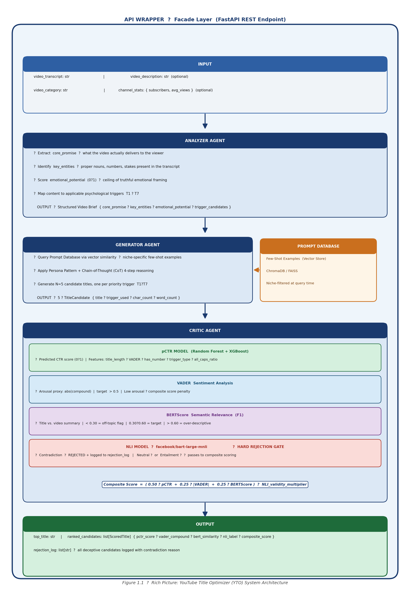

# Chapter 1: Introduction

---

## 1.1 Chapter Overview

The internet has undergone a fundamental structural shift over the past decade. Where once the primary mode of online information exchange was text (articles, blog posts, search results), video has emerged as the dominant format through which billions of people learn, discover, and decide. YouTube alone processes over 500 hours of new video content every single minute [1], creating an environment in which the challenge of digital content is no longer *production* but *discovery*. In this landscape, the metadata attached to a video, primarily its title, is the interface between a creator's work and the algorithmic systems that determine whether that work will be seen.

This chapter establishes the foundation for the research project. Section 1.2 provides the problem background, tracing the evolution of the video-first internet and the mechanics of the algorithmic discovery ecosystem that has made metadata optimization a first-order problem. Section 1.3 presents the problem statement at both a general and domain-specific level, culminating in the identification of the research gap. Section 1.4 formalises the research question. Sections 1.5 and 1.6 present the research motivation and aim. Section 1.7 states four specific research objectives. Section 1.8 provides a rich picture of the proposed solution. Sections 1.9 and 1.10 specify the resource requirements and project scope. The chapter closes with a summary in Section 1.11.

---

## 1.2 Problem Background

### The Video-First Internet

The global media ecosystem has experienced a decisive shift toward video-based communication. Platforms including YouTube, TikTok, and Instagram Reels have collectively transformed how information is consumed, making short-to-medium form video the primary medium for education, entertainment, news, and product discovery. YouTube, launched in 2005, has grown to become the world's second-largest search engine and processes more than 500 hours of uploaded video content every single minute [1]. That volume, on its own, is a structural problem of supply overwhelming demand.

In a text-based information environment, search algorithms could rely on body text, links, and explicit keyword signals to rank and surface content. In a video-first environment, the *content itself* (the audio, the video stream) is largely opaque to algorithmic indexing systems at the moment of upload. The video's textual metadata (its title, description, and tags) becomes the primary signal by which a recommender system categorises, understands, and distributes new content before any engagement data exists.

### The Algorithmic Gatekeeper: CTR and the Cold-Start Loop

YouTube's recommendation system, as documented by Covington, Adams, and Sargin (2016) in the foundational paper *Deep Neural Networks for YouTube Recommendations* [2], operates as a two-stage pipeline: a candidate generation stage that narrows billions of videos to hundreds of candidates, followed by a ranking stage that orders those candidates for individual users. The ranking stage weighs multiple signals, and click-through rate (CTR), the proportion of users who click a video upon seeing its impression, is one of the most immediate and influential of them.

The system operates through an implicit exploration-exploitation loop for new videos. When a creator uploads a new video, the algorithm serves an impression of that video to a small test cohort of users. If the CTR recorded during this test window is strong, the system expands distribution to progressively larger audiences. If CTR is weak, distribution is suppressed. This is the *cold-start problem* as it applies to YouTube content [2]: a video has no historical engagement data, so the algorithm must use the earliest available signal, the click decision made on the basis of the title and thumbnail alone, to determine whether to invest further distribution resources.

The asymmetric consequence of this mechanism is severe. A video whose title fails to generate a sufficient CTR during the cold-start window may receive permanent suppression from the recommendation engine, regardless of the actual quality of the content it contains. High-quality educational material, well-produced creative work, and valuable tutorials are all equally susceptible to this failure mode if their metadata packaging is weak. Discovery, not quality, becomes the primary determinant of a video's performance.

CTR benchmarks on YouTube illustrate the stakes: YouTube's own documentation states that half of all channels and videos have an impressions CTR between 2% and 10% [3]. On the home feed, a CTR above 7% is considered good; above 10% is a significant outlier typically associated with strong title-and-thumbnail combinations [3]. The difference between a 3% CTR and a 7% CTR, which appears small in absolute terms, translates into dramatically different levels of algorithmic amplification over time, as higher CTR produces more impressions, more watch time data, and higher rankings in a self-reinforcing feedback loop.

### The Expertise Bottleneck

Professional copywriters and experienced content creators apply a well-documented body of heuristic knowledge when crafting high-performing video titles. This knowledge encompasses psychological principles, curiosity gap construction [4], loss aversion framing [5], social proof signals [6], and emotional arousal engineering [7], as well as platform-specific rules regarding optimal length, keyword placement, numerical triggers, and audience specificity. Applying this expertise at scale runs into real limits, though.

It is *unscalable*: a professional copywriter who can craft a high-CTR title in twenty minutes cannot meaningfully serve the volume of content being produced, and at 500 hours of video uploaded per minute, no human workforce can operate at the pace required. It is also *inaccessible* in practice — most content creators (individual educators, small businesses, independent journalists, student filmmakers) have neither training in marketing psychology nor the money to retain professional copywriting services, so the expertise stays gated behind economic privilege. And even where the expertise exists, it is *inconsistent*: experienced practitioners still produce flat, uninspired titles under time pressure, fatigue, or unfamiliarity with a particular content niche.

### The Rise of LLMs and Their Generic Application Gap

The rapid development and public availability of large language models (LLMs), including GPT-4o (OpenAI), Llama 3 (Meta), and Claude (Anthropic), has opened a potential pathway toward automated, scalable title generation. These models, built on the Transformer architecture introduced by Vaswani et al. (2017) [8], demonstrate strong capabilities in creative text generation, instruction-following, and constraint satisfaction.

However, the generic application of LLMs to title generation, prompting a model with a request such as "write me a YouTube title for this video", does not resolve the expertise bottleneck. Research by Yang (2024) in *PLOS ONE* confirmed that standard AI-generated titles produced without specialised prompting strategies lack the emotional sophistication and cultural specificity that human experts apply [9]. The resulting output is typically descriptive and accurate, but psychologically flat: it tells the viewer what the video is about without creating the psychological tension that motivates a click.

A large-scale randomised field experiment by Zhang et al. (2024) involving over two million content producers on a leading short-video platform provided further empirical grounding for this limitation [10]. The study found that when videos already had human-generated titles, replacing those titles with pure AI-generated alternatives *decreased* valid watch counts by 37.9%, suggesting that naive AI title generation falls below the quality threshold that experienced human creators achieve intuitively. Critically, however, the same study found that when producers significantly revised AI-generated titles through human-AI collaboration, content consumption improved, and each 10% reduction in similarity between the AI draft and the final adopted title was associated with a 9.8% increase in valid watch counts [10]. This finding points toward a hybrid, engineered approach, where AI generation is systematically directed by psychological expertise, as the productive research direction.

---

## 1.3 Problem Statement

### 1.3.1 General Problem

At the macro level, the structural reality of algorithmically-driven content discovery creates a systemic misalignment between content quality and content visibility. YouTube distributes over 500 hours of new video every minute [1], and its recommendation algorithm uses CTR, formed in milliseconds by a viewer who reads a title, as the primary early signal for distribution decisions [2]. The consequence is that video metadata, specifically the title, exerts a disproportionate influence on a video's long-term performance relative to its actual content quality.

This creates a measurable economic and social cost. Educational content that fails to achieve adequate CTR during the cold-start window does not reach students who would benefit from it. Small business product demonstrations are buried below competitors who have invested in copywriting expertise. Independent creators with genuine talent produce high-quality work that is algorithmically invisible, not because it lacks merit, but because its packaging is suboptimal. The economic dimension extends to the creator economy itself: in a system where visibility determines monetisation, advertising revenue, and brand partnership opportunities, the ability to consistently generate effective metadata is a critical business capability that most creators lack [10].

The problem is further compounded by the reality that, as Zhang et al. (2024) documented, only 60.7% of uploaded videos on a major platform had any title at all during their study's pre-treatment period [10]. Metadata sparsity, the absence of the very signals that recommendation systems rely on to understand and distribute content, is not a marginal failure mode but a prevalent condition affecting the majority of uploaded content.

### 1.3.2 Specific Problem

At the domain-specific level, the problem narrows to the absence of a generative AI solution that occupies the intersection of three requirements that existing systems fail to satisfy simultaneously.

Existing LLM-based tools are reactive and psychologically ungrounded: they respond to explicit user prompts but do not proactively analyse video content and generate optimised titles without user direction. More critically, they do not operationalise the psychological theories (Information Gap Theory [4], Prospect Theory [5], Social Proof [6]) that the copywriting literature identifies as the mechanisms underlying high-performing titles. The result is generic, descriptive output that fails the psychological criterion for an effective click trigger. Yang (2024) confirmed this limitation empirically, demonstrating that AI-generated titles produced without specialised methodology lack the nuance human experts apply [9].

Existing analytics platforms, meanwhile, are generative-free. Tools such as TubeBuddy and VidIQ provide rich historical performance data (keyword rankings, competitor CTR benchmarks, trend analysis), but offer no capability to generate optimised titles from video content. They are purely reactive instruments that show creators what has already happened, without generating what should happen next.

And no existing tool enforces ethical faithfulness constraints alongside engagement optimisation. Clickbait detection systems (SemEval shared tasks, ClickGuard, the Webis Clickbait Corpus tools) identify deceptive headlines but provide no constructive alternative, and marketing-oriented AI tools optimise for clicks without constraining against factual misrepresentation. Unconstrained optimisation for engagement produces misleading titles, a pattern that research has shown leads to high initial CTR but devastated watch time, algorithmic penalisation, and potential violations of YouTube's Terms of Service (Section 4H), which prohibit metadata that "sets up expectations the video doesn't deliver" [11].

Furthermore, research published in *Scientific Reports* (2024) demonstrated that when curiosity-gap headline techniques became ubiquitous on platforms such as Facebook and Upworthy circa 2014, platform algorithms were adjusted to penalise them, illustrating the long-term algorithmic risk of pure engagement optimisation without truthfulness constraints [12].

The research gap is therefore the absence of a system that is simultaneously: **(1) proactive**, generating titles from content analysis without user prompt engineering; **(2) psychologically grounded**, operationalising established psychological trigger theory as explicit algorithmic instructions; **(3) generative**, producing novel, diverse title candidates rather than analysing existing ones; and **(4) ethically constrained**, enforcing semantic faithfulness to the source video as a hard system requirement. No existing academic publication or commercial tool occupies this intersection.

---

## 1.4 Research Question

### Primary Research Question

> **How can a multi-agent AI system be designed and evaluated to automatically generate YouTube video titles that are psychologically optimised for high Click-Through Rates while maintaining semantic faithfulness to the source video content?**

### Supporting Sub-Questions

**RQ1:** How can specific linguistic patterns associated with virality, including information gap structures, high-arousal sentiment, loss aversion framing, and numerical triggers, be systematically operationalised into Few-Shot and Chain-of-Thought prompt templates for Large Language Models?

**RQ2:** What is the optimal software architecture for an API Wrapper that integrates LLM-based title generation with a computational validation layer to ensure generated titles are both engagement-optimised and semantically faithful to the source content?

**RQ3:** To what extent do LLM-generated titles produced using psychologically-engineered prompt strategies outperform baseline human-generated titles and generic zero-shot AI titles, when evaluated against predicted virality metrics and human preference ratings?

**RQ4:** How can the LLM-as-a-Judge evaluation pattern be employed to automatically score and rank generated titles against a structured marketing rubric encompassing Curiosity, Urgency, and Relevance dimensions?

---

## 1.5 Research Motivation

The motivation for this research operates across three distinct dimensions: economic and social, technical, and ethical.

### 1.5.1 Economic and Social Motivation

The creator economy has grown into a multi-billion dollar industry in which individual content creators build audiences, generate revenue, and communicate expertise through video platforms. However, the skills required to succeed in this economy, specifically, the ability to write compelling, psychologically informed video metadata, are not evenly distributed. Professional marketing expertise is expensive and inaccessible to the vast majority of independent creators, educators, and small organisations. The consequence is a structural inequality in which creators with financial resources to invest in copywriting expertise enjoy algorithmic advantages over creators who produce equally or more valuable content.

Beyond commercial creators, the problem extends to educational and social impact contexts. A university professor uploading lecture content, a non-profit publishing health information, or a language teacher creating free tutorial videos all face the same discovery bottleneck. If the title does not generate an adequate CTR during the cold-start window, the content is effectively invisible to the audience it was designed to serve. Zhang et al. (2024) demonstrated that AI-assisted metadata significantly increased valid watch counts for low-skilled producers (+1.6% at access stage, +7.1% when adopted), confirming the democratising potential of engineered AI title generation [10].

This research is motivated by the opportunity to democratise access to high-quality title optimisation, placing capabilities previously available only to well-resourced creators within reach of any creator with a video transcript.

### 1.5.2 Technical Motivation

From a technical standpoint, this research addresses an open and practically important question in generative AI: whether LLMs can be systematically *steered* to optimise a specific, measurable real-world metric (predicted CTR) through engineered prompt infrastructure, rather than through weight-level training.

The distinction between zero-shot and few-shot prompting (Brown et al., 2020 [13]) and the emergence of Chain-of-Thought reasoning (Wei et al., 2022 [14]) as prompting paradigms have demonstrated that LLM behaviour is substantially shaped by how they are prompted, not only by their weights. Yet the application of these techniques to a domain as specific and psychologically complex as viral title generation remains understudied. This project contributes a novel instantiation of these techniques, a Prompt Factory that constructs psychologically-engineered, trigger-specific prompts dynamically, as a technical artefact whose performance can be measured and compared.

Furthermore, the multi-agent architecture, Analyzer -> Generator -> Critic, addresses a known limitation of single-shot generation: the conflation of content analysis, creative generation, and quality evaluation in a single model call. By separating these concerns across isolated agents, the system enforces architectural boundaries that constrain hallucination by design: the Generator reads only the Analyzer's structured brief, never the raw transcript, preventing the model from fabricating content that is not grounded in the video's actual material.

### 1.5.3 Ethical Motivation

The proliferation of clickbait, titles that systematically misrepresent or exaggerate video content to maximise initial clicks at the expense of viewer satisfaction, is a documented harm to the information ecosystem. Research has shown that curiosity-gap techniques, when overused and deployed deceptively, prompted algorithm-level countermeasures from major platforms and eroded user trust [12]. YouTube's own Terms of Service (Section 4H) explicitly prohibit metadata that creates undelivered expectations [11], and violations can result in demonetisation and channel strikes.

This research is motivated by the conviction that engaging and honest content packaging are not mutually exclusive objectives. The NLI-based faithfulness layer in this system puts that conviction into code: every generated title is automatically evaluated against the video's core promise, and any title that factually contradicts the source content is hard-rejected before it can be surfaced to the creator. This ethical constraint is a first-class architectural component, designed in from the start rather than bolted on afterward.

---

## 1.6 Research Aim

> To design, develop, and evaluate a multi-agent AI system implemented as an API Wrapper that automatically generates psychologically optimised YouTube video titles, demonstrating that generative AI can be systematically constrained to maximise predicted Click-Through Rate while preserving semantic faithfulness to the source video content.

---

## 1.7 Research Objectives

### 1.7.1 To Identify

To identify the viral linguistic features, including sentiment polarity, emotional arousal level, information gap structures, numerical triggers, and psychological trigger types (T1: Curiosity Gap, T2: Loss Aversion, T3: Social Proof, T4: Urgency, T5: Extreme/Superlative, T6: Personal Stakes, T7: Specificity), that correlate with high view velocity in YouTube trending video datasets, using feature engineering on publicly available Kaggle datasets supplemented by targeted YouTube Data API v3 scraping.

### 1.7.2 To Analyse

To analyse the effectiveness of advanced prompt engineering techniques, specifically Few-Shot Prompting [13], Chain-of-Thought (CoT) Reasoning [14], and the Persona Pattern, in operationalising psychological theories (Information Gap Theory [4], Prospect Theory [5], Social Proof [6]) within a Large Language Model generation pipeline, by comparing the structured prompting outputs against zero-shot baseline outputs on the same input content.

### 1.7.3 To Design and Develop

To design and develop a multi-agent AI system comprising an Analyzer Agent (content analysis and ground-truth extraction), a Generator Agent (psychologically-engineered title production using a dynamic Prompt Database), and a Critic Agent (scoring and validation), encapsulated as a RESTful API Wrapper using the Facade design pattern, with an integrated Predicted CTR (pCTR) machine learning model and NLP validation layer (VADER sentiment analysis, BERTScore semantic similarity, and NLI-based factual faithfulness checking).

### 1.7.4 To Evaluate

To evaluate the performance of the designed system using quantitative metrics (pCTR score, BERTScore, VADER arousal magnitude, Self-BLEU diversity, and NLI acceptance rate) and qualitative human evaluation (a preference survey with a minimum of 50 participants using a four-dimension rubric scoring Curiosity, Emotional Impact, Clarity, and Trustworthiness), benchmarked against a human-generated title baseline (Baseline A) and a zero-shot AI title baseline (Baseline B), including a secondary automated evaluation using the LLM-as-a-Judge pattern to address RQ4.

---

## 1.8 Rich Picture of the Proposed Solution

The proposed system, the YouTube Title Optimizer (YTO), operates as a multi-agent API Wrapper. The figure below illustrates the high-level information flow from input to output.

**Figure 1.1: Rich Picture: YouTube Title Optimizer (YTO) System Architecture**

The API Wrapper functions as a Facade: the consuming application (a creator's workflow tool, a browser extension, or a content management system) submits a simple HTTP request containing the video transcript and optional metadata, and receives a ranked list of psychologically optimised title candidates with scores. All internal complexity (agent orchestration, prompt construction, ML model inference, NLP validation) is hidden behind this single interface.

The Analyzer Agent extracts the semantic ground truth of the video: what it actually delivers, what entities are real and usable, what emotional framing is legitimately supportable. The Generator Agent receives only this structured brief, never the raw transcript, which is the primary architectural defence against hallucination. The Critic Agent applies four independent scoring mechanisms and enforces the hard rejection gate: any title classified as "Contradiction" to the video's core promise by the NLI model is eliminated from the output, regardless of its predicted CTR score.

---

## 1.9 Resource Requirements

### 1.9.1 Hardware

The following hardware resources are required to implement and evaluate the proposed system:

| Resource | Minimum Specification | Purpose |
|---|---|---|
| Development Machine | 16 GB RAM, 8-core CPU, 64-bit OS | LLM API calls, ML model training, agent pipeline execution |
| GPU (Recommended) | NVIDIA GPU, 8 GB+ VRAM (e.g., RTX 3060) | Accelerated NLI model inference, BERTScore computation |
| Storage | 50 GB+ SSD | Kaggle dataset storage, model weight caching, embeddings |
| Internet Connectivity | Stable broadband (10 Mbps+) | OpenAI API, Hugging Face model downloads, YouTube Data API |

GPU access is recommended but not strictly required; CPU-based inference for the NLI and BERTScore models is functional at reduced speed, and is acceptable within the evaluation latency budget (P95 < 10 seconds, end-to-end). Where GPU access is unavailable, Hugging Face's Inference API or Google Colab can substitute for model inference during development.

### 1.9.2 Software

| Software / Library | Version | Purpose |
|---|---|---|
| Python | 3.10+ | Core implementation language |
| FastAPI + Uvicorn | Latest stable | ASGI REST API backend; async LLM call handling |
| LangChain + LangGraph | Latest stable | Multi-agent orchestration; Supervisor pattern; state management |
| OpenAI Python SDK | Latest stable | GPT-4o API access for Generator and Analyzer agents |
| Hugging Face Transformers | Latest stable | `facebook/bart-large-mnli` (NLI), BERTScore inference |
| `bert-score` (Python) | Latest stable | BERTScore computation library |
| NLTK + `vaderSentiment` | Latest stable | VADER compound score for Critic agent |
| Scikit-learn | Latest stable | Random Forest pCTR model, feature preprocessing |
| XGBoost | Latest stable | XGBoost pCTR model; hyperparameter tuning |
| Sentence-Transformers | Latest stable | Prompt Database vector embeddings for few-shot retrieval |
| Kaggle CLI / API | Latest stable | Dataset download automation |
| GitHub | Free | Version control; CI/CD |
| Python dotenv | Latest stable | API key and environment management |

All dependencies are open-source or available via free-tier API access. The OpenAI API incurs per-token inference costs; the GPT-4o pricing as of the project's evaluation period is documented and version-pinned to ensure reproducibility [15].

---

## 1.10 Project Scope

### In Scope

| Element | Specification |
|---|---|
| Primary deliverable | Multi-agent AI system implemented as a RESTful API Wrapper |
| Title generation target | YouTube video titles only |
| Language | English-language titles and input transcripts |
| Input modality | Text-based input: video transcript, description, or summary |
| Engagement metric | Predicted CTR (pCTR) as the primary optimisation objective |
| Faithfulness enforcement | NLI-based hard rejection gate (Contradiction -> eliminated) |
| ML model | pCTR classifier trained on public Kaggle YouTube datasets |
| Agent pipeline | Analyzer Agent -> Generator Agent -> Critic Agent |
| Evaluation | Quantitative (pCTR, BERTScore, VADER, Self-BLEU, NLI acceptance rate) + qualitative (human survey, LLM-as-a-Judge) |
| Comparison baselines | Baseline A: human-generated titles; Baseline B: zero-shot LLM titles |
| Backend framework | FastAPI (Python) |
| Agent orchestration | LangChain + LangGraph (Supervisor pattern) |

### Out of Scope

| Element | Rationale for Exclusion |
|---|---|
| Thumbnail generation or optimisation | Requires computer vision/multimodal generation pipeline; constitutes a separate research project |
| Non-English or multilingual titles | Language-specific trigger lexicons and cultural adaptation require per-language validation; excluded to maintain evaluable scope |
| Direct video file processing (audio/visual) | System accepts text-only input; video transcription is a pre-processing step outside system boundaries |
| Live CTR measurement from real channels | Requires YouTube Studio API access with creator consent and a longitudinal study design incompatible with the project timeline |
| Real-time YouTube Studio integration | Constitutes a production deployment feature; excluded from the research prototype |
| Proprietary CTR data collection | Public datasets and normalised proxy metrics (Views/Subscriber_Count) are used instead |
| Frontend user interface or web application | System delivers a REST API; UI is a future work item |
| Production-ready commercial deployment | The artefact is a research prototype evaluated in a controlled academic setting |
| Large-scale live A/B testing on creator channels | Outside ethical scope and timeline constraints; evaluation uses offline metrics and a human preference survey |

The system is scoped as a **research prototype** whose primary contribution is the demonstration that psychologically-engineered, ethics-constrained, proactive title generation is feasible and measurably superior to baseline alternatives. Commercial productisation is acknowledged as a natural extension but is explicitly excluded from this study's claims.

---

## 1.11 Chapter Summary

This chapter has established the context, problem, and research direction for the YouTube Title Optimizer project. The video-first internet has created a structural discovery problem in which the metadata attached to a video, principally its title, functions as the primary algorithmic gatekeeper, determining whether high-quality content reaches its intended audience. YouTube's recommendation system, as documented by Covington et al. (2016) [2], uses Click-Through Rate during a cold-start test window as an early and influential distribution signal, creating an asymmetric penalty for poor titles that quality content cannot overcome after the fact.

The skill gap between professional copywriting expertise and the capabilities of most individual creators, combined with the failure of generic LLM prompting to replicate that expertise [9], defines the specific technical problem. No existing system simultaneously provides proactive title generation, psychologically-grounded prompt engineering, and semantic faithfulness enforcement, a gap confirmed by the existing systems analysis in Chapter 2.

The research aim is to design, develop, and evaluate a multi-agent AI system that bridges this gap. Four specific objectives guide the work: identifying viral linguistic features in YouTube datasets; analysing the effectiveness of Few-Shot and Chain-of-Thought prompt techniques; designing and developing the three-agent pipeline as an API Wrapper; and evaluating the system against quantitative and qualitative baselines. The scope is deliberately bounded to English-language, text-input title generation for YouTube, with real-world CTR measurement, thumbnail optimisation, and multilingual support deferred to future work.

Chapter 2 proceeds to review the relevant literature across the domains of engagement psychology, generative AI and prompt engineering, NLP evaluation techniques, and the existing tools landscape, establishing the theoretical and empirical foundations on which the system design is built.

---

## References

[1] YouTube. (2024). *YouTube for Press, Statistics.* https://blog.youtube/press/

[2] P. Covington, J. Adams, and E. Sargin, "Deep Neural Networks for YouTube Recommendations," in *Proc. 10th ACM Conf. Recommender Systems (RecSys '16)*, pp. 191–198, 2016. DOI: 10.1145/2959100.2959190

[3] YouTube Help. (2024). *Impressions and how they lead to watch time.* https://support.google.com/youtube/answer/9314486

[4] G. Loewenstein, "The psychology of curiosity: A review and reinterpretation," *Psychological Bulletin*, vol. 116, no. 1, pp. 75–98, 1994. DOI: 10.1037/0033-2909.116.1.75

[5] D. Kahneman and A. Tversky, "Prospect Theory: An Analysis of Decision under Risk," *Econometrica*, vol. 47, no. 2, pp. 263–291, 1979. DOI: 10.2307/1914185

[6] R. B. Cialdini, *Influence: The Psychology of Persuasion.* New York: Harper & Row, 1984.

[7] J. Berger and K. L. Milkman, "What Makes Online Content Viral?" *Journal of Marketing Research*, vol. 49, no. 2, pp. 192–205, 2012. DOI: 10.1509/jmr.10.0353

[8] A. Vaswani et al., "Attention Is All You Need," in *Advances in Neural Information Processing Systems (NeurIPS)*, 2017. arXiv: 1706.03762

[9] W. Yang, "Beyond algorithms: The human touch machine-generated titles for enhancing click-through rates on social media," *PLOS ONE*, vol. 19, no. 7, e0306639, Jul. 2024. DOI: 10.1371/journal.pone.0306639

[10] X. Zhang, C. Sun, R. Zhang, and K.-Y. Goh, "The Value of AI-Generated Metadata for UGC Platforms: Evidence from a Large-scale Field Experiment," arXiv:2412.18337, Dec. 2024.

[11] YouTube. (2024). *Terms of Service, Section 4H.* https://www.youtube.com/t/terms

[12] "When curiosity gaps backfire: effects of headline concreteness on information selection decisions," *Scientific Reports*, 2024. DOI: 10.1038/s41598-024-81575-9

[13] T. B. Brown et al., "Language Models are Few-Shot Learners," in *Advances in Neural Information Processing Systems (NeurIPS)*, 2020. arXiv: 2005.14165

[14] J. Wei et al., "Chain-of-Thought Prompting Elicits Reasoning in Large Language Models," in *Advances in Neural Information Processing Systems (NeurIPS)*, 2022. DOI: 10.5555/3600270.3602070

[15] OpenAI. (2024). *GPT-4o Model Card and Pricing.* https://openai.com/pricing

---

*Chapter 1, Introduction | P.A.D.B. Pathiraja (29071) | BSc (Hons) Software Engineering | NSBM Green University*
