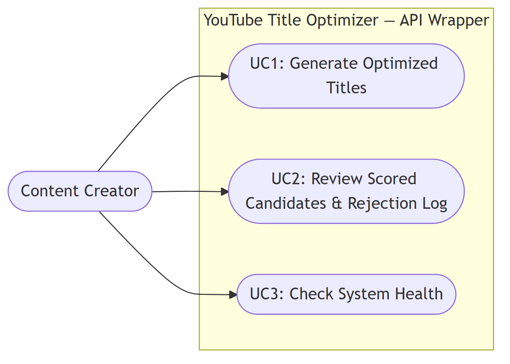
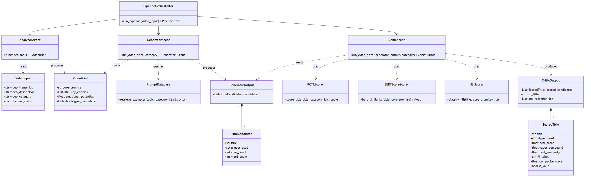
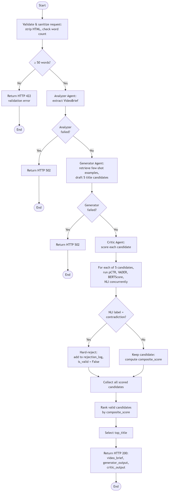
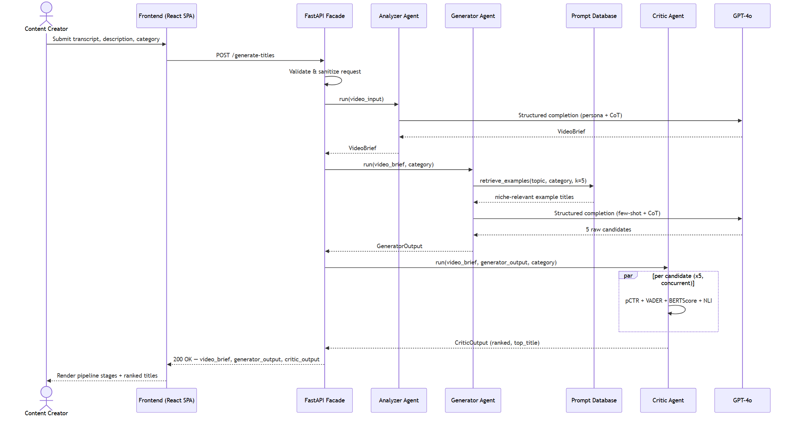
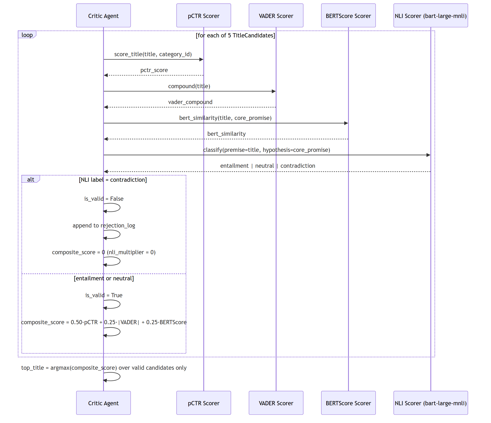
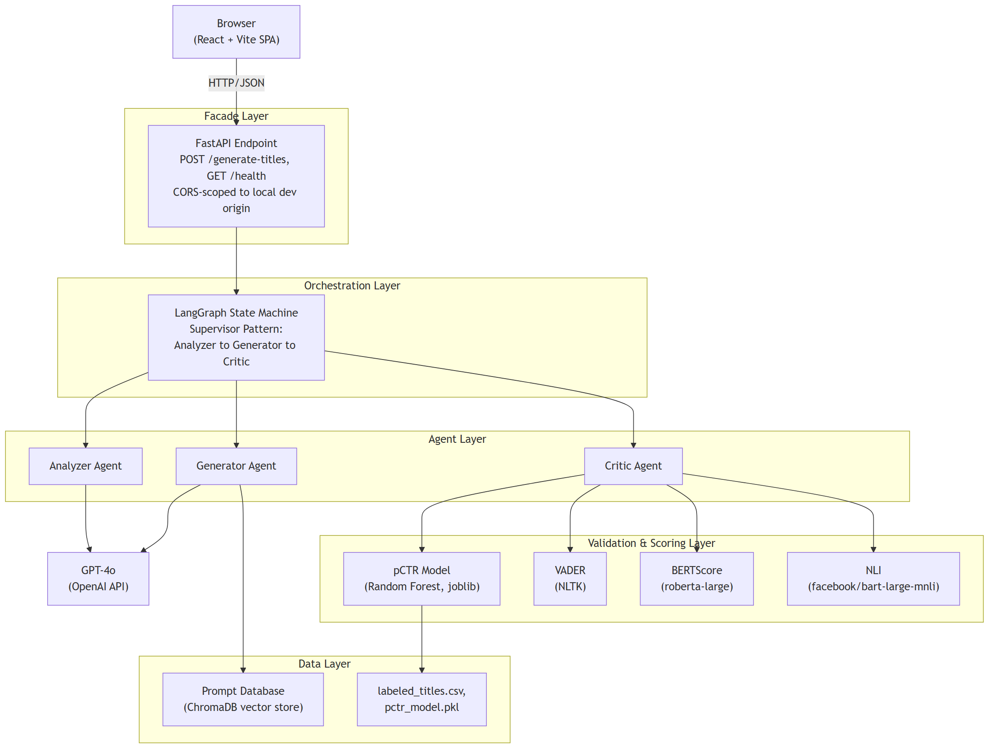

# Chapter 4: System Requirements Specification

---

## 4.1 Chapter Overview

Chapter 3 established the philosophical and procedural framework governing this research: a pragmatist, abductive, Design-Science approach executed through Peffers' six-phase DSRM. This chapter operationalises that framework into a concrete system specification. It identifies who the system serves, traces each research objective from Chapter 1 down to the specific component that satisfies it, and formalises the system's behaviour through the standard Unified Modelling Language (UML) diagram set [4]: use case, class, activity, and sequence diagrams. The chapter closes with the functional and non-functional requirements that the implemented system, described in full in Chapter 5, was built to satisfy.

Section 4.2 identifies the stakeholders of the system and their respective interests. Section 4.3 traces the operationalisation of the four research objectives into concrete architectural components. Section 4.4 presents the use case model. Section 4.5 presents the class model of the shared data contracts and agent components. Section 4.6 presents the activity model of the end-to-end request lifecycle. Section 4.7 presents sequence diagrams for the two behaviourally distinct execution paths: the successful generation path and the NLI rejection path. Section 4.8 presents the proposed system architecture in full. Sections 4.9 and 4.10 specify the functional and non-functional requirements respectively, stated in a form that is directly verifiable against the evaluation reported in Chapter 6. Section 4.11 closes the chapter.

Because implementation (Sprints 1–5) preceded the writing of this chapter, the diagrams and requirements presented here describe the system as it was actually built and verified, not a forward-looking design that implementation later deviated from. Where an as-built decision differs from what a purely top-down requirements process might have specified, that decision is noted and justified in place.

---

## 4.2 Stakeholder Analysis

Three distinct stakeholder groups have an interest in the YouTube Title Optimizer (YTO), each with a different relationship to the system and a different basis for evaluating its success.

**Content Creators** are the primary human stakeholder and the system's direct user. A creator interacts with the system by submitting a video transcript, an optional description, and a content category, and receives a ranked set of title candidates with interpretable per-title scores. Their interest is in reducing the time and expertise cost of producing an effective title while retaining final editorial control. The system is positioned as a co-pilot, per the transparency principle established in Section 3.9.4, not an autonomous publisher. Sub-populations within this group (individual educators, small businesses, and independent journalists identified in Section 1.5.1) share this interest but differ in their baseline access to professional copywriting expertise, which is precisely the inequality the system is motivated to reduce.

**Researchers and Academic Evaluators**, including the project supervisor and thesis examiners, are stakeholders in the system's rigor and evaluability rather than its day-to-day use. Their interest is in whether the system's design decisions are theoretically grounded (Section 2.5), whether its performance claims are measured against defensible baselines and metrics (Section 3.6, Activity 5), and whether the artefact constitutes a genuine, reproducible research contribution rather than an opaque or unfalsifiable claim. This stakeholder group is served directly by the evaluation methodology detailed in Chapter 6.

**The Platform Algorithm** is a non-human but architecturally significant stakeholder. YouTube's recommendation system, as characterised in Section 2.3.2, is the actual consumer of the system's output in the sense that it is the mechanism that converts a generated title into real-world distribution outcomes. The system does not interact with this stakeholder directly (no live API call is made to YouTube's ranking system, per the scope boundary in Section 1.10), but every design decision in the Critic Agent (Section 4.5, Section 4.8) is oriented toward producing titles that would perform well under this stakeholder's actual ranking behaviour, and the pCTR model (Section 2.5.1, A6) exists specifically to proxy this stakeholder's response in the absence of a live integration.

A fourth, indirect stakeholder group, **video viewers** (the audience whose click decisions the system is ultimately trying to earn), is acknowledged but not directly engaged by the system's interfaces. The NLI faithfulness gate (Section 4.6, Section 4.7) acts as this stakeholder's proxy representative within the architecture: it exists specifically to prevent the system from optimising creator and platform interests at the viewer's expense through deceptive titling, operationalising the ethical position established in Section 3.9.1.

---

## 4.3 Operationalisation Process

Table 4.1 traces each of the four research objectives stated in Section 1.7 to the specific system component or process that satisfies it, closing the loop between the research questions posed in Chapter 1 and the concrete architecture presented in this chapter.

**Table 4.1 — Operationalisation of Research Objectives**

| Research Objective (§1.7) | System Component | Verification Point |
|---|---|---|
| 1.7.1 To Identify viral linguistic features and the T1–T7 trigger taxonomy | Feature engineering pipeline (Section 2.5.1, W1); Analyzer Agent's `trigger_candidates` extraction (Section 4.5) | Feature importance ranking against the trained pCTR model (Chapter 6) |
| 1.7.2 To Analyse the effectiveness of Few-Shot, CoT, and Persona prompting | Generator Agent's Prompt Factory: dynamic Prompt Database retrieval (Section 4.8) + four-step CoT sequence + persona system prompt | Comparison against the zero-shot Baseline B (Chapter 6) |
| 1.7.3 To Design and Develop the three-agent pipeline as a Facade-pattern API Wrapper | Analyzer → Generator → Critic pipeline (Section 4.6), orchestrated by the LangGraph state machine, exposed through the FastAPI Facade (Section 4.8) | End-to-end pipeline execution (Chapter 5) |
| 1.7.4 To Evaluate the system against quantitative and qualitative baselines | Critic Agent's composite scoring (Section 4.7); offline ML evaluation, system-level evaluation, human preference survey, LLM-as-a-Judge scoring | Chapter 6 |

The operationalisation reveals a structural property of the design: each research objective maps to exactly one primary component, and the three agent components (Analyzer, Generator, Critic) collectively cover Objectives 1.7.1 through 1.7.3, while Objective 1.7.4 is satisfied by processes external to the runtime pipeline: the evaluation scripts and human-facing survey instrument described in Chapter 6. This separation is deliberate: the production pipeline that a creator invokes contains no evaluation logic beyond the Critic's real-time scoring, keeping the artefact itself lean while the research evaluation apparatus is built and run independently against it.

---

## 4.4 Use Case Diagrams

The system exposes exactly three use cases to its single human actor, the Content Creator, corresponding to the two REST endpoints described in Section 4.8, modelled following the use-case-driven approach established by Jacobson et al. [3]. All three use cases are presented in the body, as their combined number falls within the three-diagram limit specified by the project template.

**Figure 4.1 — Use Case Diagram: Content Creator and the YTO API Wrapper**

**UC1: Generate Optimised Titles.** The creator submits a video transcript (minimum 50 words, enforced at the API boundary), an optional description, and a content category. The system returns five ranked, scored title candidates. This is the primary use case and the one through which every other research objective is ultimately exercised.

**UC2: Review Scored Candidates and Rejection Log.** Because the API response includes each candidate's individual pCTR, VADER, BERTScore, and NLI scores alongside the ranked list, and any hard-rejected candidates with their rejection reason, the creator can inspect why a given title was ranked, or excluded, rather than receiving an opaque final answer. This use case is satisfied by the structure of UC1's response rather than by a separate endpoint, consistent with the transparency principle established in Section 3.9.4.

**UC3: Check System Health.** A lightweight `GET /health` endpoint allows a consuming application to confirm the service is available and to retrieve the active model versions (the LLM identifier and the pCTR model type) before submitting a generation request, which matters for any client application built against this API Wrapper, including the demonstration frontend described in Chapter 5.

---

## 4.5 Class Diagram

The system's data contracts are implemented as Pydantic models, which serve simultaneously as runtime validation schemas and as the class model presented here. Figure 4.2 shows the data classes exchanged between pipeline stages, the three agent components (represented as classes exposing a single `run()` operation, consistent with their actual module-level implementation), and their principal collaborators.

**Figure 4.2 — Class Diagram: Data Contracts, Agents, and Supporting Services**

Three design decisions embedded in this class structure are architecturally significant. First, `GeneratorAgent` has no association with `VideoInput`: its `run()` operation accepts only a `VideoBrief` and a category string, never the raw transcript. This is the anti-hallucination boundary discussed in Section 1.5.2 and Section 4.6, and enforcing it at the type level, rather than merely by convention, means the Generator is structurally incapable of fabricating detail beyond what the Analyzer has grounded in the source transcript. Second, `CriticAgent` depends on three independent scorer classes (`PCTRScorer`, `BERTScoreScorer`, `NLIScorer`) rather than implementing scoring logic internally, reflecting the two-layer relevance-then-faithfulness design discussed in Section 2.5.1 (A4, A5). Third, `PipelineOrchestrator` is the only class with a dependency on all three agents, consistent with the Supervisor pattern (Section 2.5.2, D1); no agent class has a direct dependency on another agent.

---

## 4.6 Activity Diagram

Figure 4.3 traces the complete control flow of a single request from submission to response, including the two categories of failure path the implemented system distinguishes: request validation failure (HTTP 422) and pipeline execution failure (HTTP 502).

**Figure 4.3 — Activity Diagram: End-to-End Request Lifecycle**

The diagram makes explicit a property of the Critic Agent's internal behaviour that is easy to understate in prose: the four scoring computations (pCTR, VADER, BERTScore, NLI) for a single candidate execute concurrently rather than sequentially, and this concurrency is itself replicated across all five candidates in a batch. This design choice (discussed further in Chapter 5) was adopted after an early implementation measured an unacceptable end-to-end latency when candidates were scored one at a time; the activity diagram reflects the concurrent version that satisfies the latency requirement stated in Section 4.10.

The NLI decision point is the diagram's single most consequential branch. A "contradiction" classification routes a candidate to hard rejection regardless of how favourably it scores on the other three metrics: the composite score formula (Section 4.7) is constructed so that a rejected candidate's contribution is multiplied by zero rather than merely down-weighted. This is the architectural instantiation of the persuasion-versus-manipulation boundary discussed in Section 3.9.1.

---

## 4.7 Sequence Diagrams

Two sequence diagrams are presented, corresponding to the two behaviourally distinct paths through the system: the successful generation path spanning all three agents (Figure 4.4), and the internal scoring and rejection logic of the Critic Agent in isolation (Figure 4.5). Together these cover both the inter-agent orchestration and the intra-agent decision logic that the activity diagram (Section 4.6) presents only at a summary level.

**Figure 4.4 — Sequence Diagram: Successful Generation Path**

Figure 4.4 shows the full request lifecycle across the Facade, the three agents, the external LLM, and the Prompt Database, including the frontend client introduced in Chapter 5. Two properties are notable. First, the Generator Agent's call to the Prompt Database occurs before its call to the LLM: the retrieved few-shot examples are injected into the generation prompt, not consulted afterward, which is what makes the retrieval genuinely few-shot rather than a post-hoc filter. Second, the Critic Agent's five-way parallel scoring (denoted by the `par` fragment) is shown as a single logical step in this diagram; its internal structure is expanded separately in Figure 4.5, since interleaving both levels of detail in one diagram would obscure the top-level orchestration this diagram is intended to communicate.

**Figure 4.5 — Sequence Diagram: Critic Agent Scoring and Rejection Logic**

Figure 4.5 makes the composite scoring formula's conditional behaviour explicit as a sequence of messages rather than a static equation:

$$\text{composite\_score} = \left(0.50 \cdot \text{pCTR} + 0.25 \cdot |\text{VADER}| + 0.25 \cdot \text{BERTScore}\right) \times \text{nli\_multiplier}$$

where `nli_multiplier` is 1 for an `entailment` or `neutral` classification and 0 for `contradiction`. The weighting (0.50 / 0.25 / 0.25) reflects the initial design decision recorded in Section 2.5.1 that predicted engagement (pCTR) should dominate the ranking of already-faithful candidates, with arousal and relevance acting as secondary differentiators; this weighting is treated as a tunable parameter, not a fixed theoretical claim, and its sensitivity is not separately ablated within this project's evaluation scope.

---

## 4.8 Proposed System Architecture Diagram

Figure 4.6 presents the complete system architecture as five layers: the client layer (the browser-based frontend introduced as a scope amendment, discussed in Chapter 5), the Facade layer (the single FastAPI entry point), the orchestration layer (the LangGraph state machine), the agent layer (the three specialised agents), and the validation and data layers (the ML and NLP scoring services and their supporting datasets).

**Figure 4.6 — Proposed System Architecture**

The architecture instantiates the Facade design pattern of Gamma et al. [1], described in Section 2.5.2 (D2), at the FastAPI boundary: every internal complexity below the Facade layer (agent orchestration, prompt construction, vector retrieval, four independent scoring computations) is invisible to any consumer of the API, whether that consumer is the project's own demonstration frontend, a future browser extension, or a third-party content management system, per the extensibility argument made in Section 1.8. The orchestration layer's isolation from the agent layer reflects the Supervisor pattern (Section 2.5.2, D1) implemented via LangGraph [5]: the state machine holds no domain logic of its own, only the sequencing and error-propagation rules that determine which agent runs next and how a failure in one agent short-circuits the remainder of the pipeline.

A point worth making explicit: the validation layer's four components (pCTR, VADER, BERTScore, NLI) are all invoked exclusively by the Critic Agent, and none of them are reachable by the Generator Agent. This is not an oversight but a direct consequence of the Supervisor pattern's sequential dependency: a candidate cannot be scored before it exists, so no scoring service has any reason to be visible to the agent that creates candidates. The Prompt Database, by contrast, is reachable only by the Generator Agent, since it is a generation-time input rather than a post-hoc evaluation signal.

---

## 4.9 Functional Requirements

Following the standard functional/non-functional requirement distinction [2], the functional requirements below are stated at the granularity that Chapter 6's evaluation directly verifies, and are numbered independently of the non-functional requirements in Section 4.10.

**Table 4.2 — Functional Requirements**

| ID | Requirement |
|---|---|
| FR1 | The system shall accept a video transcript, an optional description, and a content category via a single HTTP POST request. |
| FR2 | The system shall reject a request whose transcript contains fewer than 50 words with an HTTP 422 response identifying the validation failure. |
| FR3 | The system shall sanitise all free-text input by stripping HTML tags and normalising whitespace before it reaches any agent. |
| FR4 | The Analyzer Agent shall extract a `core_promise`, `key_entities`, an `emotional_potential` score, and a set of `trigger_candidates` from the transcript, including no entity that is not verbatim or a direct paraphrase of transcript content. |
| FR5 | The Generator Agent shall receive only the Analyzer's structured brief and the content category (never the raw transcript) as input to title generation. |
| FR6 | The Generator Agent shall produce exactly five title candidates per request, no two of which share the same psychological trigger. |
| FR7 | The Generator Agent shall reject, at generation time, any candidate title exceeding 100 characters. |
| FR8 | The Critic Agent shall compute a predicted CTR score, a VADER arousal score, and a BERTScore relevance score for every candidate. |
| FR9 | The Critic Agent shall classify every candidate's relationship to the video's core promise as `entailment`, `neutral`, or `contradiction` using an NLI model, and shall hard-reject any candidate classified as `contradiction`, excluding it from ranking regardless of its other scores. |
| FR10 | The system shall return a single top-ranked title alongside all scored candidates and a log of any rejected candidates with their rejection reason. |
| FR11 | The system shall expose a health-check endpoint reporting service availability and the active LLM and pCTR model versions. |

---

## 4.10 Non-Functional Requirements

**Table 4.3 — Non-Functional Requirements**

| ID | Category | Requirement |
|---|---|---|
| NFR1 | Performance | The system shall return a response within 10 seconds at the 95th percentile (P95) of requests, end-to-end. |
| NFR2 | Reliability | A failure in any single agent shall produce a structured HTTP 502 error response identifying the failing stage, rather than an unhandled exception or a silent partial result. |
| NFR3 | Scalability | The Facade layer shall handle concurrent requests without blocking, exploiting the asynchronous I/O characteristics of LLM API calls rather than a synchronous request-per-process model. |
| NFR4 | Security | All free-text input shall be sanitised at the API boundary before being incorporated into any downstream prompt, and cross-origin access shall be restricted to explicitly configured origins rather than left unrestricted. |
| NFR5 | Maintainability | Each agent shall be independently testable in isolation from the other two, with its input and output types defined by shared, versioned data contracts rather than ad hoc dictionaries. |
| NFR6 | Interpretability | Every score contributing to a candidate's ranking shall be individually retrievable in the API response, rather than the system exposing only a final rank or a single opaque score. |
| NFR7 | Reproducibility | The pCTR model's training and evaluation split shall be deterministic and reproducible from a fixed random seed, such that a re-run of the offline evaluation produces identical metrics. |

NFR1, in particular, is stated as a hard verification target rather than an aspiration: Section 6.2 reports the measured P95 latency against this exact threshold, and NFR7 is verified directly by the reproduced test-set F1-score reported in Section 6.1.

---

## 4.11 Chapter Summary

This chapter has translated the research aims and methodological commitments of Chapters 1 through 3 into a formal system specification. The stakeholder analysis identified content creators, academic evaluators, and the (indirectly engaged) YouTube platform algorithm as the parties with a material interest in the system's design and performance. The operationalisation table in Section 4.3 traced each of the four research objectives to a specific architectural component, closing the loop between research question and system design. The UML model (use case, class, activity, and sequence diagrams) formalised the system's behaviour at four complementary levels of abstraction, from the single human actor's interaction surface down to the Critic Agent's internal scoring decision logic. The architecture diagram in Section 4.8 presented the complete five-layer system, instantiating the Supervisor and Facade patterns established in the literature review. Sections 4.9 and 4.10 stated eleven functional and seven non-functional requirements in a form directly verifiable against the evaluation results reported in Chapter 6.

Chapter 5 proceeds to the implementation itself: the concrete code, prompt engineering, and integration decisions through which the architecture specified in this chapter was realised, including the tech stack justification, representative code listings for each agent, and a sample end-to-end system output.

---

## References

[1] E. Gamma, R. Helm, R. Johnson, and J. Vlissides, *Design Patterns: Elements of Reusable Object-Oriented Software.* Reading, MA: Addison-Wesley, 1994.

[2] I. Sommerville, *Software Engineering*, 10th ed. Harlow: Pearson Education, 2016.

[3] I. Jacobson, M. Christerson, P. Jonsson, and G. Övergaard, *Object-Oriented Software Engineering: A Use Case Driven Approach.* Wokingham: Addison-Wesley, 1992.

[4] Object Management Group, *OMG Unified Modeling Language (OMG UML), Version 2.5.1.* OMG Document formal/2017-12-05, Dec. 2017.

[5] LangChain. (2024). *Multi-Agent Systems — Supervisor Pattern.* LangChain Documentation. https://docs.langchain.com/oss/python/langchain/multi-agent

---

*Chapter 4 — System Requirements Specification | P.A.D.B. Pathiraja (29071) | BSc (Hons) Software Engineering | NSBM Green University*
