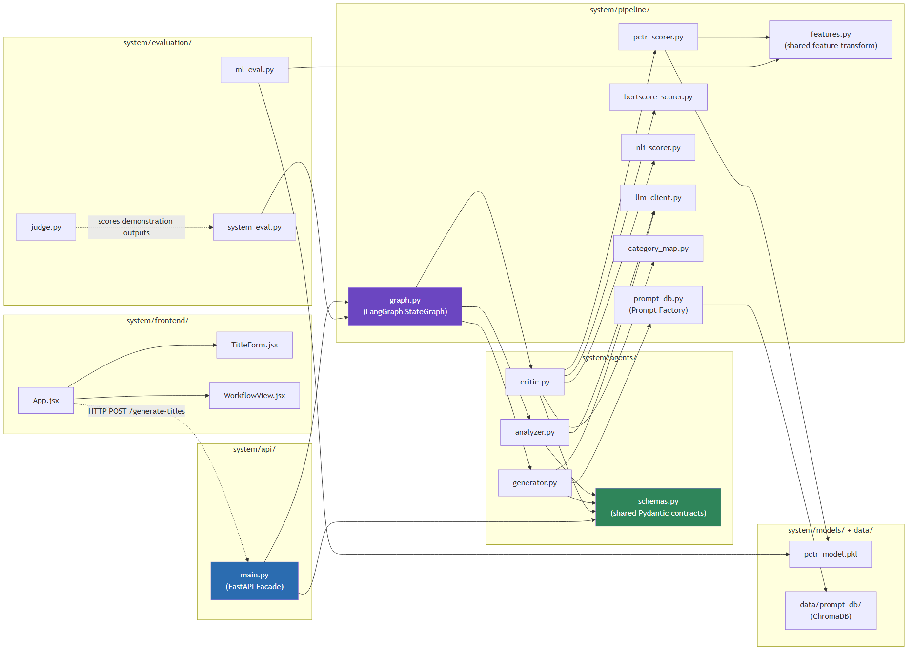
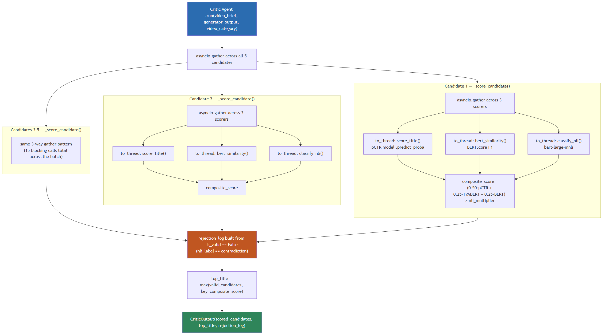
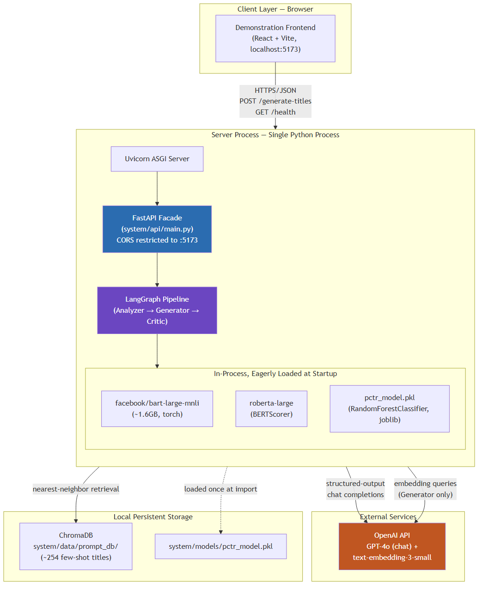

# Chapter 5: Implementation

---

## 5.1 Chapter Overview

Chapter 4 specified the system as a formal architecture: three agents, a validation layer, and a Facade boundary, expressed through UML diagrams and eleven functional and seven non-functional requirements. This chapter describes how that specification was actually realised in code across Sprints 1–5 (29 June – 9 August 2026). It follows the same as-built discipline established in Chapter 4: every listing reproduced here is drawn directly from the working repository, not from a forward-looking design, and every deliberate deviation from the original implementation plan is documented in place rather than silently absorbed.

Section 5.2 justifies the technology stack against the alternatives considered. Section 5.3 orients the reader to the repository's module structure. Sections 5.4 through 5.8 walk the pipeline in execution order (Analyzer, Prompt Factory and Prompt Database, Generator, the predicted-CTR (pCTR) machine learning model, and Critic), pairing each with a representative code listing. Section 5.9 covers the two components that make the agents consumable as a single system: the LangGraph orchestration layer and the FastAPI Facade. Section 5.10 documents the browser-based demonstration frontend, a scope amendment introduced after Sprint 5 and not present in the original implementation plan. Section 5.11 presents one complete, real system output end-to-end. Section 5.12 consolidates the implementation-level deviations from `PLAN_IMPLEMENTATION.md` into a single account. Section 5.13 closes the chapter.

---

## 5.2 Technology Stack and Justification

Table 5.1 restates the technology choices introduced in Section 2.5.1 and Table 4.3, this time justified against the alternatives that were considered and rejected during implementation rather than at the design stage.

**Table 5.1 — Technology Stack and Justification**

| Layer | Technology | Alternative Considered | Reason for Final Choice |
|---|---|---|---|
| Backend framework | Python 3.10 + FastAPI | Flask, Django REST Framework | Native `async`/`await` support is not incidental: every agent call and every Critic scorer is I/O- or CPU-bound and benefits from concurrent execution (Section 5.8); Flask requires a separate ASGI shim to get this, Django REST Framework is oriented toward synchronous ORM-backed CRUD APIs this system does not need. Pydantic-based request/response validation (FR1–FR3, Section 4.9) is also native to FastAPI rather than bolted on. |
| Agent orchestration | LangGraph (`StateGraph`) | Hand-rolled sequential function calls | A plain `await analyzer.run(); await generator.run(); await critic.run()` chain would satisfy the happy path, but LangGraph's typed state dictionary and explicit node/edge graph (Section 5.9) make the per-node error-short-circuiting behaviour required by NFR2 (Section 4.10) a structural property of the graph definition rather than something re-implemented at every call site. |
| LLM provider | OpenAI GPT-4o (`langchain-openai`) | Llama 3 (local inference) | GPT-4o's native structured-output mode (`with_structured_output`, Section 5.4) maps directly onto the Pydantic schemas in `system/agents/schemas.py`, removing an entire class of JSON-parsing failure that a locally-hosted Llama 3 would require additional constrained-decoding tooling to match. Llama 3 remains documented as a viable cost-reduction path (Section 2.5.1, A1) but was not exercised in this implementation; GPT-4o was used throughout. |
| Sentiment/arousal | VADER (NLTK) | A fine-tuned transformer sentiment classifier | VADER requires no GPU and returns a result in single-digit milliseconds, which matters directly for the NFR1 latency budget (Section 4.10) given that arousal scoring happens once per candidate, five times per request. Hutto and Gilbert's validation on short, informal social text [1] is a closer domain match to a YouTube title than a classifier trained on long-form review text. |
| Semantic relevance | BERTScore (`bert-score`, roberta-large) | Cosine similarity over sentence-transformer embeddings | BERTScore's token-level greedy matching [2] was already the mechanism specified in Section 2.5.1 (A4); no alternative was substituted during implementation. |
| Faithfulness gate | `facebook/bart-large-mnli` | `roberta-large-mnli` | Both are viable per Section 2.5.1 (A5); `bart-large-mnli` was selected for implementation because its HuggingFace checkpoint ships with a directly usable three-way `contradiction`/`neutral`/`entailment` label mapping (`model.config.id2label`) with no additional label-remapping step. |
| pCTR model | scikit-learn `RandomForestClassifier` (final), XGBoost (evaluated) | A regression variant predicting a continuous virality score | A classification framing (above/below category-median virality) was retained throughout, consistent with Section 3.4's target-variable design; RMSE-based regression evaluation was accordingly never applicable (Section 6.1) and this is noted rather than silently omitted wherever the plan's checklist mentions it. |
| Vector store | ChromaDB (persistent client) | FAISS | ChromaDB's `PersistentClient` gives the Prompt Database (Section 5.5) on-disk persistence and metadata filtering (`where={"category_id": ...}`) without a separate index-file management layer, which FAISS would require alongside a hand-rolled metadata store. |
| Embeddings | OpenAI `text-embedding-3-small` | `sentence-transformers` (local) | Consistent with using the same provider (OpenAI) for both generation and embedding calls, keeping the Generator's two external dependencies (chat model, embedding model) under a single API key and billing surface. |

---

## 5.3 Repository and Module Structure

The implementation is organised under `system/`, matching the structure fixed in `CLAUDE.md` and `PLAN_IMPLEMENTATION.md`. Figure 5.1 shows the module-level dependency structure (which concrete file imports which) as the code-level counterpart to the class diagram of Section 4.5, which modelled data contracts and agent classes rather than file-level module boundaries. Table 5.2 restates the same mapping as a lookup table, associating each module with the architectural component it implements.



**Figure 5.1 — Module Dependency Structure**

Two properties of Figure 5.1 are worth drawing out explicitly. First, `schemas.py` sits at the centre of the `agents/` subgraph with incoming edges only: every agent module imports from it, and it imports from nothing else in the codebase. That is the module-level expression of the "shared, versioned data contracts" required by NFR5 (Section 4.10). Second, the three scorer modules (`pctr_scorer.py`, `bertscore_scorer.py`, `nli_scorer.py`) are reachable only from `critic.py`, never from `generator.py`, reproducing at the file-dependency level the same "no scoring service is visible to the agent that creates candidates" property that Section 4.8 established at the architecture-diagram level.

**Table 5.2 — Module-to-Architecture Mapping**

| Module | Architectural Component (Ch. 4) |
|---|---|
| `system/agents/schemas.py` | Shared Pydantic data contracts (`VideoInput`, `VideoBrief`, `TitleCandidate`, `GeneratorOutput`, `ScoredTitle`, `CriticOutput`) — the class diagram's data classes |
| `system/agents/analyzer.py`, `generator.py`, `critic.py` | The three agent classes |
| `system/pipeline/graph.py` | `PipelineOrchestrator` — the LangGraph Supervisor |
| `system/pipeline/prompt_db.py` | The Prompt Factory / Prompt Database |
| `system/pipeline/pctr_scorer.py`, `bertscore_scorer.py`, `nli_scorer.py` | `PCTRScorer`, `BERTScoreScorer`, `NLIScorer` |
| `system/pipeline/features.py` | The shared feature-engineering transform used at both training and inference time |
| `system/api/main.py` | The FastAPI Facade |
| `system/frontend/` | The client layer introduced in Section 5.10 |
| `system/evaluation/` | The Chapter 6 evaluation apparatus (external to the runtime pipeline, per Section 4.3) |

---

## 5.4 Analyzer Agent

The Analyzer Agent (Section 4.5; SOT §12.1) is a single async function, `run()`, rather than a class with internal state: each request is independent and the agent holds nothing between calls. Its output type is `VideoBrief`, and its entire responsibility is to ground that output in the transcript it is given, since it is the only pipeline component that ever sees `video_input.video_transcript`.

**Listing 5.1 — Analyzer Agent (`system/agents/analyzer.py`, abridged)**

```python
PERSONA = (
    "You are an analytical video content expert. You read raw video "
    "transcripts and extract only what is factually present — you do not "
    "embellish, infer beyond the text, or add creative interpretation."
)

INSTRUCTIONS = """\
Analyze the video content below and produce a structured brief by working \
through these steps:

Step 1: What does this video actually deliver to the viewer? Summarize this \
as one factual sentence — the core_promise.

Step 2: What real entities (proper nouns, numbers, names, stakes) are \
explicitly present in the transcript? List them as key_entities.

Step 3: What is the strongest truthful emotional angle this content \
authentically supports? Score this as emotional_potential, a float from 0 \
(no emotional angle) to 1 (maximum authentic emotional intensity).

Step 4: Which of the following psychological triggers authentically apply \
to this content, based only on what is actually in the transcript? ...

CRITICAL ANTI-HALLUCINATION CONSTRAINT: Only include an entity in \
key_entities if it is verbatim or a clear, direct paraphrase of something \
stated in the transcript. If you are unsure whether something was actually \
stated, omit it. ...
"""

async def run(video_input: VideoInput) -> VideoBrief:
    llm = get_chat_model(temperature=0.2)
    structured_llm = llm.with_structured_output(VideoBrief)

    prompt = INSTRUCTIONS.format(
        video_transcript=video_input.video_transcript,
        video_description=video_input.video_description or "(none provided)",
        video_category=video_input.video_category,
    )
    messages = [
        {"role": "system", "content": PERSONA},
        {"role": "user", "content": prompt},
    ]
    return await structured_llm.ainvoke(messages)
```

Two implementation choices are worth drawing out. First, `temperature=0.2` is deliberately low relative to the Generator's `temperature=0.9` (Section 5.6): the Analyzer's task is extraction, not creativity, and a low temperature reduces the chance of the model paraphrasing loosely enough to drift from the transcript's literal content. Second, `llm.with_structured_output(VideoBrief)` binds GPT-4o's native structured-output mode directly to the Pydantic `VideoBrief` class from `schemas.py` (Listing 5.5), and that same class is simultaneously the runtime validation schema, the type the rest of the pipeline imports, and the object LangChain coerces the model's JSON response into. This removes a manual `json.loads` plus schema-validation step that a less structured LLM API would require, and means a malformed model response fails fast as a Pydantic validation error rather than propagating a malformed dictionary downstream.

The anti-hallucination constraint stated in the prompt (Section 4.5's discussion of the class diagram) is reinforced, not replaced, by the architectural boundary: the Generator's function signature (Section 5.6) simply has no parameter through which a raw transcript could pass, so even a prompt-injection attempt embedded in the transcript that successfully persuaded the Analyzer to leak transcript text into `key_entities` still could not make that text reach the Generator by any other channel than `key_entities` itself, where the entailment/contradiction check in Section 5.8 still applies to whatever the Generator produces from it.

---

## 5.5 Prompt Factory and Dynamic Prompt Database

Section 2.5.1 (A2) and Section 13 of the SOT establish few-shot prompting, Chain-of-Thought reasoning, and the Persona pattern as the three prompt-engineering techniques the Generator combines. The few-shot layer is dynamic, retrieved per request from a vector store, rather than a fixed block of examples pasted into every prompt, and this retrieval is implemented in `system/pipeline/prompt_db.py`.

**Listing 5.2 — Prompt Database build and retrieval (`system/pipeline/prompt_db.py`, abridged)**

```python
TOP_N_PER_CATEGORY = 15  # ~15 categories -> roughly 200 titles total

def build() -> None:
    df = pd.read_csv(DATA_PATH)
    top = (
        df.sort_values("virality_score", ascending=False)
        .groupby("category_id", group_keys=False)
        .head(TOP_N_PER_CATEGORY)
        .copy()
    )
    top["hook_type"] = top["title"].apply(classify_hook_type)

    embeddings = OpenAIEmbeddings(model=EMBEDDING_MODEL, api_key=OPENAI_API_KEY)
    vectors = embeddings.embed_documents(top["title"].tolist())

    client = chromadb.PersistentClient(path=str(PROMPT_DB_DIR))
    collection = client.create_collection(COLLECTION_NAME)
    collection.add(
        ids=[...], embeddings=vectors, documents=top["title"].tolist(),
        metadatas=[{"category_id": int(cat), "hook_type": hook}
                   for cat, hook in zip(top["category_id"], top["hook_type"])],
    )

def retrieve_examples(topic: str, category: str, k: int = 5) -> List[str]:
    embeddings = OpenAIEmbeddings(model=EMBEDDING_MODEL, api_key=OPENAI_API_KEY)
    query_vector = embeddings.embed_query(topic)

    client = chromadb.PersistentClient(path=str(PROMPT_DB_DIR))
    collection = client.get_collection(COLLECTION_NAME)

    category_id = category_name_to_id(category)
    result = collection.query(
        query_embeddings=[query_vector], n_results=k,
        where={"category_id": category_id},
    )
    documents = result["documents"][0] if result["documents"] else []

    if len(documents) < k:  # sparse category -> fall back to an unfiltered search
        fallback = collection.query(query_embeddings=[query_vector], n_results=k)
        # ... merge, deduplicate, cap at k
    return documents[:k]
```

`build()` is an offline, one-time step run via `python -m system.pipeline.prompt_db`, not part of the request path; `retrieve_examples()` is the function the Generator calls synchronously (wrapped in `asyncio.to_thread` where called concurrently elsewhere in the pipeline) on every request.

Two deviations from `PLAN_IMPLEMENTATION.md` §3.1 are embedded in this listing and are documented here rather than in the plan file alone, since they materially affect how retrieval behaves. First, the plan specified selecting the top-200 highest-virality titles globally; `build()` instead selects the top 15 *per category*. A flat global top-200 was tried first and concentrated almost entirely in a small number of viral-outlier categories (Music, Shorts, movie trailers), which meant a query for an Education or Travel video had few or no same-category examples to retrieve, defeating the purpose of niche-specific few-shot retrieval that Section 13.1 of the SOT specifies. Second, the plan specified manually annotating 200 titles by Hook Type; `classify_hook_type()` (not reproduced in full here) is instead a heuristic keyword/regex classifier reusing the Analyzer's own T1–T7 trigger vocabulary, applied automatically to the full ~200-title set. Both deviations follow the same pattern documented for the Sprint 1 dataset-cleaning heuristics (Section 6.1): a manual, more rigorous alternative was substituted with a faster heuristic under the project's time constraints, and the substitution is disclosed rather than hidden.

The `retrieve_examples()` fallback path, querying without the category filter when fewer than `k` category-matched results exist, exists for the same reason the per-category rebuild does: an unfiltered fallback is strictly better than returning fewer than five examples, which would leave the Generator's few-shot block sparse for the thinnest categories in the dataset.

---

## 5.6 Generator Agent

The Generator (SOT §12.2) receives only a `VideoBrief` and a category string, never `video_input`, and produces exactly five `TitleCandidate` objects. Its prompt combines all three layers from Section 2.5.1 (A2): the Persona system message, the dynamically retrieved few-shot examples from Section 5.5, and an explicit Chain-of-Thought instruction sequence.

**Listing 5.3 — Generator prompt construction (`system/agents/generator.py`, abridged)**

```python
def _build_prompt(video_brief: VideoBrief, examples: List[str]) -> str:
    triggers = video_brief.trigger_candidates or list(_TRIGGER_NAMES.keys())
    ...
    return f"""\
Video brief:
  core_promise: {video_brief.core_promise}
  key_entities: {", ".join(video_brief.key_entities) or "(none)"}
  ...

Here are high-performing titles in this niche:
{example_lines}
Learn from their structure and psychological trigger patterns — do not copy them verbatim.

Work through these steps:
Step 1: Identify the core Information Gap or Conflict a viewer would want resolved, based only on the video brief above.
Step 2: Determine the strongest high-arousal emotional angle this content authentically supports.
Step 3: Draft one title for each of the authentically applicable triggers listed above.
Step 4: Include at least one loss-framing (T2) variant in the batch if the brief authentically supports a loss/mistake/avoidable-outcome framing; otherwise use the next-strongest applicable trigger instead — never fabricate a loss angle that isn't grounded in the brief.
{{numeric-variant step, conditional on key_entities containing a number}}
Step 6: Refine each title for mobile impact — target 55-70 characters, hard cap 100.
Step 7: Return exactly 5 titles, each tagged with the trigger it uses.

Constraints:
- Every title must be a truthful representation of core_promise — no claims beyond the video brief.
- No title may exceed 100 characters.
- TRIGGER DIVERSITY IS MANDATORY: each of the 5 titles must use a different trigger from each other. ...
"""

async def run(video_brief: VideoBrief, video_category: str) -> GeneratorOutput:
    examples = retrieve_examples(topic=video_brief.core_promise, category=video_category, k=5)
    llm = get_chat_model(temperature=0.9)
    structured_llm = llm.with_structured_output(_RawGeneratorOutput)
    raw_output = await structured_llm.ainvoke([...])

    candidates = [_to_candidate(c) for c in raw_output.candidates]
    oversized = [c.title for c in candidates if c.char_count > MAX_CHARS]
    if oversized:
        raise ValueError(f"Generator produced title(s) over the {MAX_CHARS}-char hard cap: {oversized}")
    return GeneratorOutput(candidates=candidates)
```

The `TRIGGER DIVERSITY IS MANDATORY` constraint is a direct product of test-driven refinement rather than a first-draft design decision. The first prompt version omitted this explicit instruction and satisfied Sprint 3's exit criterion (Section 6.6.2's antecedent, `PLAN_IMPLEMENTATION.md` §3.5) in 9 of 10 test cases; the tenth, a numbers-heavy brief, produced five candidates that all converged on the T7 (Number + Specificity) trigger, since it was the most obviously applicable one. Adding the explicit diversity constraint and re-running the same 10 cases resolved the failure. This is retained here as evidence that the CoT sequence alone (Wei et al. [3]) does not automatically guarantee constraint satisfaction on a structural property like "no two candidates share a trigger"; that property required an explicit, separately stated instruction.

The 100-character hard cap is enforced twice: once in the prompt text (`Step 6`, `Constraints`) as a soft steering signal to the LLM, and once again after generation as a hard `ValueError` on any oversized title. The prompt-level instruction reduces how often the post-hoc check actually fires, but the post-hoc check is what the system actually relies on to guarantee FR7 (Section 4.9). An LLM's adherence to a stated character limit is a strong tendency, not a guarantee, and the second check exists because the first one is not sufficient on its own.

---

## 5.7 Predicted-CTR (pCTR) Machine Learning Model

The pCTR model is the only non-LLM learned component in the pipeline, trained offline in Sprint 1 (`system/notebooks/model_training.ipynb`) on the cleaned, feature-engineered dataset (`labeled_titles.csv`, 154,471 rows) and consumed at inference time by the Critic Agent through `system/pipeline/pctr_scorer.py`.

**Listing 5.4 — Feature engineering, shared between training and inference (`system/pipeline/features.py`, abridged)**

```python
def build_features(df, title_col="title", subscriber_col="subscriber_count"):
    out = df.copy()
    out["title_length_chars"] = out[title_col].str.len()
    out["title_word_count"] = out[title_col].str.split().apply(len)
    out["has_number"] = out[title_col].apply(lambda t: bool(NUMBER_RE.search(t)))
    out["number_value"] = out[title_col].apply(number_value)

    vs = out[title_col].apply(lambda t: vader.polarity_scores(t))
    out["vader_compound"] = vs.apply(lambda d: d["compound"])
    out["vader_positive"] = vs.apply(lambda d: d["pos"])

    out["first_word_type"] = out[title_col].apply(first_word_type)   # spaCy POS tag
    out["has_question"] = out[title_col].str.contains("\\?")
    out["has_exclamation"] = out[title_col].str.contains("!")
    out["all_caps_ratio"] = out[title_col].apply(all_caps_ratio)
    out["has_emoji"] = out[title_col].apply(lambda t: any(c in emoji.EMOJI_DATA for c in t))

    if subscriber_col in out.columns:
        out["channel_subscriber_tier"] = pd.cut(out[subscriber_col], bins=SUB_TIER_BINS, labels=SUB_TIER_LABELS, right=False).astype(str)
    else:
        out["channel_subscriber_tier"] = SUB_TIER_LABELS[0]
    return out


def build_features_single(title: str, category_id: int, subscriber_count: int | None = None) -> pd.DataFrame:
    """Single-title convenience wrapper for live scoring (Critic agent)."""
    row = {"title": title, "category_id": category_id}
    df = pd.DataFrame([row])
    return build_features(df)
```

The design decision underlying `features.py` is deliberate module sharing rather than a convenience refactor: `build_features()` is called both from the Sprint 1 training notebook and, via the single-row wrapper `build_features_single()`, from the Critic Agent's live scoring path (Listing 5.6). No feature-computation logic is duplicated between training and inference. This directly satisfies NFR7 (Section 4.10, reproducibility) at a level below the fixed random seed the requirement text focuses on: even a perfectly reproducible train/test split would produce misleading live predictions if the inference-time feature transform silently diverged from the one the model was trained on, and sharing the module is what rules that failure mode out structurally rather than by convention.

`channel_subscriber_tier` exposes a limitation acknowledged explicitly rather than concealed: neither Kaggle source dataset (Section 3.4) ships a `subscriber_count` field, so this feature defaults to the lowest tier (`"0-10K"`) for every row in the training data and for every live prediction at inference time. The feature remains present in the schema because it is called for by SOT §15.2, but it is not currently informative; `Virality_Score` is likewise computed as `Views / category-median Views` rather than the SOT-specified `Views / Subscriber_Count`, for the same reason. Both deviations are also recorded in `PLAN_IMPLEMENTATION.md` §1.2 and §1.4 and are restated here because they directly bound how Chapter 6's feature-importance findings should be read.

**Listing 5.5 — Live pCTR scoring (`system/pipeline/pctr_scorer.py`, abridged)**

```python
_bundle = joblib.load(MODEL_PATH)          # loaded once at module import
_model = _bundle["model"]
_feature_cols = _bundle["feature_cols"]
_encoders = _bundle["categorical_encoders"]

def score_title(title: str, category_id: int) -> Tuple[float, float]:
    """Returns (pctr_score, vader_compound) for a single title."""
    row = build_features_single(title, category_id).iloc[0]

    features = {}
    for col in _feature_cols:
        if col.endswith("_enc"):
            base_col = col[: -len("_enc")]
            features[col] = _safe_encode(_encoders[base_col], row[base_col])
        else:
            features[col] = row[col]

    X = pd.DataFrame([features])[_feature_cols].astype(float)
    pctr_score = float(_model.predict_proba(X)[0, 1])
    return pctr_score, float(row["vader_compound"])
```

The saved model bundle (`pctr_model.pkl`) packages the trained classifier together with the exact ordered feature-column list and the fitted categorical label encoders used at training time, rather than saving the classifier alone. This was a direct response to a class of bug that a bare `joblib.dump(model)` would not catch: if a categorical encoder at inference time were re-fitted from scratch on a single-row DataFrame, its `classes_` would trivially be that one row's values, silently producing nonsensical encodings. `_safe_encode()` additionally falls back to encoding 0 for any category value the training-time encoder never saw (for example, a `first_word_type` POS tag that does not occur in the training vocabulary for an unusually short or malformed title) rather than raising and taking down the whole scoring request over one categorical feature.

The final selected model is a `RandomForestClassifier`; XGBoost was trained and tuned in parallel per `PLAN_IMPLEMENTATION.md` §1.5 but did not outperform it on validation F1. Reported performance (test F1 = 0.6901, ROC-AUC = 0.7613) is below the SOT's F1 > 0.75 target; this gap was deliberately deferred on 2026-08-10 to avoid blocking Sprint 3 on further hyperparameter search, and Chapter 6 reports it as the actual result rather than as a target that was met. `channel_subscriber_tier`'s lack of live signal (above) is one plausible, though not confirmed, contributor to this gap, since it removes a feature that prior published work (Section 2.5.1, A6) treats as informative.

---

## 5.8 Critic Agent

The Critic Agent (SOT §12.3) is the pipeline's gatekeeper: it scores all five Generator candidates in parallel and computes a composite score for ranking, per the formula established in Section 4.7.

**Listing 5.6 — Critic Agent scoring and rejection (`system/agents/critic.py`, abridged)**

```python
W_PCTR, W_VADER, W_BERT = 0.50, 0.25, 0.25

async def _score_candidate(video_brief, category_id, candidate) -> ScoredTitle:
    (pctr_score, vader_compound), bert_sim, nli_label = await asyncio.gather(
        asyncio.to_thread(score_title, candidate.title, category_id),
        asyncio.to_thread(bert_similarity, candidate.title, video_brief.core_promise),
        asyncio.to_thread(classify_nli, candidate.title, video_brief.core_promise),
    )
    is_valid = nli_label != "contradiction"
    nli_multiplier = 1.0 if is_valid else 0.0
    composite_score = (
        W_PCTR * pctr_score + W_VADER * abs(vader_compound) + W_BERT * bert_sim
    ) * nli_multiplier
    return ScoredTitle(title=candidate.title, trigger_used=candidate.trigger_used,
                        pctr_score=pctr_score, vader_compound=vader_compound,
                        bert_similarity=bert_sim, nli_label=nli_label,
                        composite_score=composite_score, is_valid=is_valid)

async def run(video_brief, generator_output, video_category) -> CriticOutput:
    category_id = category_name_to_id(video_category)
    scored_candidates = await asyncio.gather(
        *[_score_candidate(video_brief, category_id, c) for c in generator_output.candidates]
    )
    rejection_log = [
        f"{c.title!r} rejected: NLI contradiction against core_promise ({video_brief.core_promise!r})"
        for c in scored_candidates if not c.is_valid
    ]
    valid_candidates = [c for c in scored_candidates if c.is_valid]
    top_title = max(valid_candidates, key=lambda c: c.composite_score).title if valid_candidates else ""
    return CriticOutput(scored_candidates=list(scored_candidates), top_title=top_title, rejection_log=rejection_log)
```

Three points connect this listing back to the design decisions of Chapter 4. First, `nli_multiplier` is exactly the zero/one gate specified in the composite-score formula of Section 4.7: a `contradiction` classification eliminates a candidate from ranking by multiplying its score to zero rather than by removing it from the list, which is why `scored_candidates` in the response always contains all five candidates (satisfying FR10's requirement to return the full scored list and a separate rejection log, Section 4.9) even when one or more are invalid. Second, the three scorers for a single candidate (pCTR, BERTScore, NLI) are dispatched together via `asyncio.gather` over `asyncio.to_thread`, and this is itself nested inside a second `asyncio.gather` across all five candidates in `run()`, so a single Critic invocation issues fifteen concurrent blocking calls rather than fifteen sequential ones. This concurrency was not part of the original Sprint 4 implementation; it was added in Sprint 5 (Section 5.9) after end-to-end latency measurement showed it was necessary to meet NFR1.

Figure 5.2 makes the two nested levels of concurrency in this listing explicit: the outer `asyncio.gather` across all five candidates, and, within each candidate, the inner three-way `asyncio.gather` across the pCTR, BERTScore, and NLI scorers, each dispatched via `asyncio.to_thread`.



**Figure 5.2 — Critic Agent Parallel Scoring**

The diagram's structure explains why the Sprint 5 latency fix (Section 5.9) had the effect it did: prior to this concurrency, all fifteen blocking calls in Figure 5.2 executed one after another on a single thread, so the Critic's contribution to end-to-end latency scaled linearly with the number of candidates and scorers; with the nested `gather`/`to_thread` structure shown here, the fifteen calls instead overlap, bounded in practice by the slowest individual scorer call rather than their sum.

Third, the NLI and BERTScore models are loaded *eagerly at module import* rather than lazily on first request (visible in Listings 5.7 and the `nli_scorer.py`/`bertscore_scorer.py` source, not reproduced in full here). This was not a performance optimisation but a correctness fix for a genuine concurrency bug encountered while building the parallel scoring above: the first time `_score_candidate` ran across five candidates concurrently, two different threads simultaneously triggered the first-use lazy load of `bart-large-mnli` (NLI) and `roberta-large` (BERTScore) respectively, and this corrupted `transformers`/`accelerate`'s meta-device weight materialisation, raising `RuntimeError: Tensor on device cpu is not on the expected device meta!`. The failure reproduced reliably under the full API test suite. A `threading.Lock` scoped to each individual model's *load* did not fix it: a single isolated load in isolation succeeded every time, but two *different* models loading concurrently on two separate threads still corrupted state. That indicated the problem was cross-model rather than per-model, and only loading both models once at process startup, before any concurrent request could reach them, eliminated the race entirely. A lightweight `threading.Lock` around each model's forward pass at inference time was kept as additional insurance, since `torch`'s inference-mode thread safety guarantees under concurrent calls from a thread pool are not something this implementation chose to rely on being perfect.

---

## 5.9 LangGraph Orchestration and FastAPI Facade

The Analyzer → Generator → Critic sequence is wired together by a LangGraph `StateGraph` (Section 4.8, Supervisor pattern) and exposed to the outside world through a single FastAPI Facade endpoint (Section 4.4, UC1).

**Listing 5.7 — Pipeline state graph (`system/pipeline/graph.py`, abridged)**

```python
class PipelineState(TypedDict, total=False):
    video_input: VideoInput
    video_brief: VideoBrief
    generator_output: GeneratorOutput
    critic_output: CriticOutput
    error: Optional[str]

async def _analyzer_node(state: PipelineState) -> dict:
    try:
        brief = await analyzer.run(state["video_input"])
        return {"video_brief": brief}
    except Exception as exc:
        return {"error": f"Analyzer failed: {exc}"}

async def _generator_node(state: PipelineState) -> dict:
    if state.get("error"):
        return {}
    try:
        output = await generator.run(state["video_brief"], state["video_input"].video_category)
        return {"generator_output": output}
    except Exception as exc:
        return {"error": f"Generator failed: {exc}"}

# _critic_node follows the same pattern

def build_graph():
    graph = StateGraph(PipelineState)
    graph.add_node("analyzer", _analyzer_node)
    graph.add_node("generator", _generator_node)
    graph.add_node("critic", _critic_node)
    graph.set_entry_point("analyzer")
    graph.add_edge("analyzer", "generator")
    graph.add_edge("generator", "critic")
    graph.add_edge("critic", END)
    return graph.compile()

async def run_pipeline(video_input: VideoInput) -> PipelineState:
    return await get_graph().ainvoke({"video_input": video_input})
```

Each node's own `try`/`except` is what implements NFR2's structured-failure requirement (Section 4.10): a failure anywhere writes `error` into the shared state rather than raising past the graph boundary, and every downstream node checks `state.get("error")` before doing any work, so a failed Analyzer call correctly prevents the Generator and Critic nodes from running against a missing `video_brief`, without any node needing to know which earlier node might have failed. This is tested directly by monkeypatching the Generator to raise and confirming the response surfaces as an HTTP 502 (`test_pipeline_error_surfaces_as_502`, `PLAN_IMPLEMENTATION.md` §5.3), rather than being assumed to work from reading the code alone.

**Listing 5.8 — FastAPI Facade (`system/api/main.py`, abridged)**

```python
app = FastAPI(title="AI-Powered YouTube Title Optimizer")
app.add_middleware(CORSMiddleware, allow_origins=["http://localhost:5173"], allow_methods=["*"], allow_headers=["*"])

MIN_TRANSCRIPT_WORDS = 50

def _sanitize(text: str) -> str:
    return _WHITESPACE_RE.sub(" ", _HTML_TAG_RE.sub(" ", text)).strip()

class GenerateTitlesRequest(BaseModel):
    video_transcript: str
    video_description: Optional[str] = None
    video_category: str
    channel_stats: Optional[dict] = None

    @field_validator("video_transcript")
    @classmethod
    def _validate_transcript(cls, v: str) -> str:
        cleaned = _sanitize(v)
        word_count = len(cleaned.split())
        if word_count < MIN_TRANSCRIPT_WORDS:
            raise ValueError(f"video_transcript must have at least {MIN_TRANSCRIPT_WORDS} words (got {word_count}) — insufficient signal for the Analyzer")
        return cleaned

@app.get("/health")
async def health():
    return {"status": "ok", "model_versions": {"llm": LLM_MODEL, "pctr_model": PCTR_MODEL_NAME}}

@app.post("/generate-titles", response_model=GenerateTitlesResponse)
async def generate_titles(request: GenerateTitlesRequest):
    video_input = VideoInput(video_transcript=request.video_transcript, video_description=request.video_description,
                              video_category=request.video_category, channel_stats=request.channel_stats)
    result = await run_pipeline(video_input)
    if result.get("error"):
        raise HTTPException(status_code=502, detail=result["error"])
    return GenerateTitlesResponse(video_brief=result["video_brief"], generator_output=result["generator_output"],
                                   critic_output=result["critic_output"])
```

`_sanitize()` strips HTML tags and collapses whitespace, satisfying FR3 and NFR4 (Section 4.9, 4.10); its docstring in the source is explicit that this is `strip_tags` semantics for cleaning LLM-prompt input, not an XSS-safe HTML sanitiser, because the sanitised text is never rendered as HTML anywhere in the system; it only ever reaches an LLM prompt. This distinction matters because a reviewer familiar with web security might otherwise assume a stronger guarantee than the function actually provides; stating the limitation directly in the code is preferable to leaving it to be discovered later. `GenerateTitlesRequest`'s `field_validator` methods run automatically as part of FastAPI's request parsing, so a transcript under 50 words never reaches `run_pipeline()` at all: it fails at the Pydantic validation boundary with an HTTP 422, before a single LLM call is made, satisfying FR2 and avoiding the (larger) cost of running the Analyzer against insufficient input.

---

## 5.10 Demonstration Frontend

`system/frontend/` is a Vite + React single-page application that is not part of the original implementation plan; it was added after Sprint 5 as a scope amendment to give the system a usable demonstration surface for evaluation purposes and for presenting the artefact to examiners, and is reflected retroactively in the architecture diagram (Figure 4.6) and both sequence diagrams (Section 4.7) as the client layer.

**Listing 5.9 — Frontend request flow (`system/frontend/src/App.jsx`, abridged)**

```jsx
async function handleSubmit(formValues) {
  setLoading(true); setError(null); setResult(null);
  try {
    const response = await generateTitles(formValues);
    setResult(response);
  } catch (err) {
    setError(err.message);
  } finally {
    setLoading(false);
  }
}

return (
  <main className="app">
    <TitleForm onSubmit={handleSubmit} loading={loading} />
    {error && <div className="error-banner">{error}</div>}
    {result && (
      <WorkflowView videoBrief={result.video_brief}
                    generatorOutput={result.generator_output}
                    criticOutput={result.critic_output} />
    )}
  </main>
);
```

The frontend is a thin client in the strictest sense: `App.jsx` holds no domain logic of its own beyond loading and error state, and `WorkflowView` (not reproduced here) renders the three pipeline stage outputs (`video_brief`, `generator_output`, `critic_output`) directly as returned by `/generate-titles`, satisfying UC2's transparency requirement (Section 4.4) at the presentation layer rather than requiring a second API call. Because the frontend consumes exactly the same REST contract any other client would, it also serves as a live integration check on the Facade boundary described in Section 4.8: the Facade's public interface was never special-cased for this particular consumer. The frontend's CORS origin (`http://localhost:5173`, Listing 5.8) is the Vite development server; a production deployment would require this to be reconfigured to the deployed frontend's origin, which is noted as an outstanding operational step rather than a defect, since this project's scope (Section 1.10) explicitly excludes production deployment.

---

Figure 5.3 situates the frontend within the complete deployed system, showing the boundary between the browser client, the single Python server process, and the two categories of external dependency the server calls out to at runtime: the OpenAI API (invoked on every request) and the two locally loaded transformer models (loaded once, at process startup, per the concurrency fix discussed in Section 5.8).



**Figure 5.3 — Deployment and Component View**

The diagram makes visible a property of the implementation that is easy to miss when reading the agent code in isolation: everything inside the "In-Process, Eagerly Loaded at Startup" boundary (the NLI model, the BERTScore model, and the pCTR model bundle) lives in the memory of a single Uvicorn worker process, not behind a separate model-serving service. This is consistent with the Sprint 5 exit criteria (Section 5.9) being met within a single-process deployment, and it is also the reason the production command documented in `PLAN_IMPLEMENTATION.md` §5.2 (`gunicorn ... -w 4`) would multiply memory consumption by the worker count: each of the four workers would independently load its own ~1.6GB NLI model and BERTScore model at startup, a direct consequence of the eager-loading fix rather than a separate deployment concern, and one this project's scope (Section 1.10, prototype rather than production deployment) does not require resolving further.

## 5.11 Sample End-to-End System Output

To make the preceding sections concrete, Table 5.3 reproduces one real, unedited output recorded during the Sprint 6 system-level evaluation (Section 6.2; `system/evaluation/outputs/system_eval_results.json`), for a Science & Technology video whose brief concerned whether upgrading to a Pixel 9 Pro was worthwhile.

**Table 5.3 — Sample End-to-End Output (Science & Technology category)**

| Field | Value |
|---|---|
| `top_title` | "Why Upgrading to the Pixel 9 Pro Might Cost You" |
| `n_candidates` / `n_valid` | 5 / 5 (no NLI rejections on this run) |
| Top candidate `pctr_score` | 0.647 |
| `vader_arousals` across the 5 candidates | [0.0, 0.0, 0.2263, 0.0, 0.0] |
| `bert_similarities` across the 5 candidates | [0.875, 0.895, 0.877, 0.884, 0.869] |
| `self_bleu` (batch-internal diversity) | 0.110 |
| End-to-end latency | 15.05 s |

Two observations from this single run anticipate the aggregate findings reported in Chapter 6 rather than being unique to this example. First, four of the five `vader_arousals` are exactly 0.0. The top-ranked title itself scores 0.0 despite being the highest-composite-score candidate, since its loss-framing (T2) language ("...Might Cost You") registers as VADER-neutral even though it is plausibly evocative to a human reader. This is a specific instance of the system-wide gap between average VADER arousal (0.265) and its target (> 0.4) reported in Section 6.2, and illustrates concretely why that gap was written up as a lexicon-coverage limitation of VADER on curiosity/loss-framed titles rather than as a failure of the Generator to produce emotionally engaging language. Second, all five `bert_similarities` cluster tightly in the high 0.86–0.90 range, above the SOT's 0.60 "potentially boring/descriptive" watch-line (Section 2.5.1, A4). This is again a single-run instance of the system-wide BERTScore-too-high finding (Section 6.2), consistent with titles tracking `core_promise` closely as a direct consequence of the anti-hallucination grounding constraint (Section 5.4) being effective at faithfulness while conservative on creative divergence. This single run's latency of 15.05 seconds is notably above the P95 = 9.95 s figure reported for the full 20-run evaluation batch in Section 6.2: evaluation runs execute back-to-back rather than under the isolated conditions of the Sprint 5 latency benchmark (Section 5.8), so individual run latency within that batch is not directly comparable to the P50/P95 figures computed across it.

---

## 5.12 Implementation Deviations from the Plan

Table 5.4 consolidates, in one place, every implementation-level deviation from `PLAN_IMPLEMENTATION.md` documented across this chapter, since Chapter 6's evaluation results are only interpretable correctly with these deviations in view.

**Table 5.4 — Consolidated Implementation Deviations**

| Deviation | Section | Reason |
|---|---|---|
| Prompt Database built as top-15-per-category (~254 titles) instead of a flat global top-200 | 5.5 | Flat top-200 concentrated in a few viral-outlier categories, starving other categories of same-category examples |
| Hook Type labelling is a heuristic keyword classifier, not manual annotation of 200 titles | 5.5 | Time-constrained substitution, reusing the Analyzer's own T1–T7 vocabulary rather than introducing a new taxonomy |
| Critic scoring parallelised via `asyncio.gather`/`to_thread` rather than a `ProcessPoolExecutor` | 5.8 | A process pool would re-load the pCTR/BERTScore/NLI models per worker process; a thread pool exploits that sklearn/torch release the GIL during inference |
| NLI and BERTScore models loaded eagerly at import, not lazily on first request | 5.8 | Concurrent lazy loading of two different transformer models on different threads corrupted `transformers`/`accelerate`'s meta-device weight materialisation |
| `channel_subscriber_tier` defaults to `"0-10K"` for all rows; `Virality_Score` uses category-median Views, not Subscriber_Count | 5.7 | Neither Kaggle source dataset ships a subscriber-count field |
| Frontend (Vite + React) added after Sprint 5 | 5.10 | Not in the original plan; added as a scope amendment for a usable demonstration and evaluation surface |
| pCTR model shipped below its SOT target (F1 = 0.6901 vs. > 0.75) | 5.7 | Wider hyperparameter search was scoped but deliberately deferred (2026-08-10) to avoid blocking downstream sprints on a partial-point F1 gap |

None of these deviations were made silently; each is documented at the point in the codebase where it occurs (as the in-code comments reproduced across this chapter's listings show) and cross-referenced from `PLAN_IMPLEMENTATION.md`'s own sprint checklists.

---

## 5.13 Chapter Summary

This chapter has traced the system specified in Chapter 4 down to the code that implements it. Section 5.2 justified the technology stack against the alternatives considered during implementation, not only at the design stage. Sections 5.4 through 5.8 walked the Analyzer, Prompt Factory, Generator, pCTR model, and Critic in execution order, each paired with a listing drawn directly from the working repository and an explanation of the non-obvious implementation decisions embedded in it: the anti-hallucination boundary enforced at the function-signature level, the trigger-diversity constraint added after empirical failure, the shared feature-transform module, and the concurrency fix required to make parallel Critic scoring correct rather than merely fast. Section 5.9 showed how LangGraph and FastAPI compose these agents into the single Facade specified in Section 4.8, with per-node error handling as a structural property of the graph rather than an afterthought. Section 5.10 documented the demonstration frontend as an explicit, reasoned scope amendment. Section 5.11 grounded all of the above in one real end-to-end output, and Section 5.12 consolidated every implementation deviation from the plan into a single account.

Chapter 6 proceeds to the evaluation of this implemented system: the offline machine-learning metrics for the pCTR model, the system-level metrics computed across the full demonstration set (of which Section 5.11's sample is one instance), the human preference survey, and the LLM-as-a-Judge comparison against the descriptive and zero-shot baselines.

---

## References

[1] C. J. Hutto and E. Gilbert, "VADER: A Parsimonious Rule-Based Model for Sentiment Analysis of Social Media Text," in *Proc. 8th Int. AAAI Conf. Weblogs and Social Media (ICWSM)*, 2014.

[2] T. Zhang, V. Kishore, F. Wu, K. Q. Weinberger, and Y. Artzi, "BERTScore: Evaluating Text Generation with BERT," in *Proc. Int. Conf. Learning Representations (ICLR)*, 2020.

[3] J. Wei, X. Wang, D. Schuurmans, M. Bosma, B. Ichter, F. Xia, E. Chi, Q. Le, and D. Zhou, "Chain-of-Thought Prompting Elicits Reasoning in Large Language Models," in *Proc. Neural Information Processing Systems (NeurIPS)*, 2022.

[4] T. Brown, B. Mann, N. Ryder, M. Subbiah, J. D. Kaplan, P. Dhariwal, A. Neelakantan, et al., "Language Models are Few-Shot Learners," in *Proc. Neural Information Processing Systems (NeurIPS)*, 2020.

[5] M. Lewis, Y. Liu, N. Goyal, M. Ghazvininejad, A. Mohamed, O. Levy, V. Stoyanov, and L. Zettlemoyer, "BART: Denoising Sequence-to-Sequence Pre-training for Natural Language Generation, Translation, and Comprehension," in *Proc. 58th Annual Meeting of the Association for Computational Linguistics (ACL)*, 2020.

[6] F. Pedregosa, G. Varoquaux, A. Gramfort, V. Michel, B. Thirion, O. Grisel, et al., "Scikit-learn: Machine Learning in Python," *Journal of Machine Learning Research*, vol. 12, pp. 2825–2830, 2011.

[7] T. Chen and C. Guestrin, "XGBoost: A Scalable Tree Boosting System," in *Proc. 22nd ACM SIGKDD Int. Conf. Knowledge Discovery and Data Mining*, 2016.

---

*Chapter 5 — Implementation | P.A.D.B. Pathiraja (29071) | BSc (Hons) Software Engineering | NSBM Green University*
