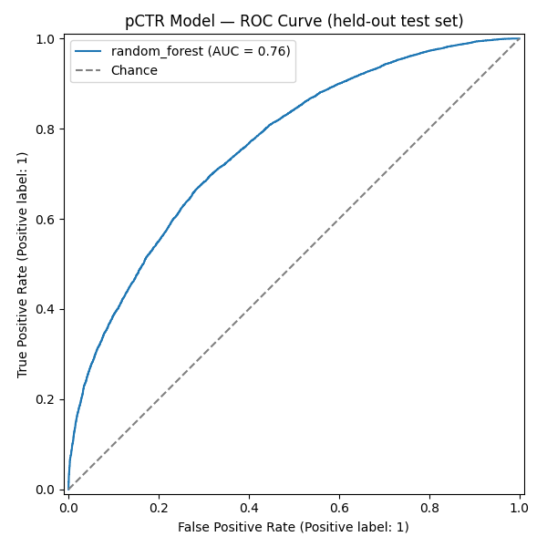
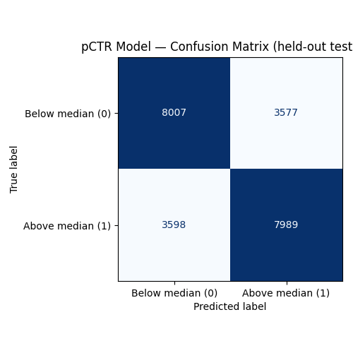
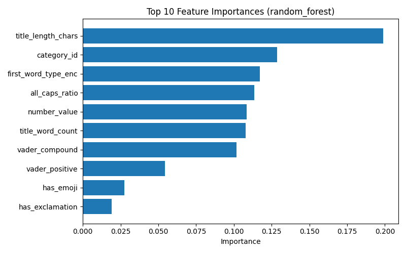
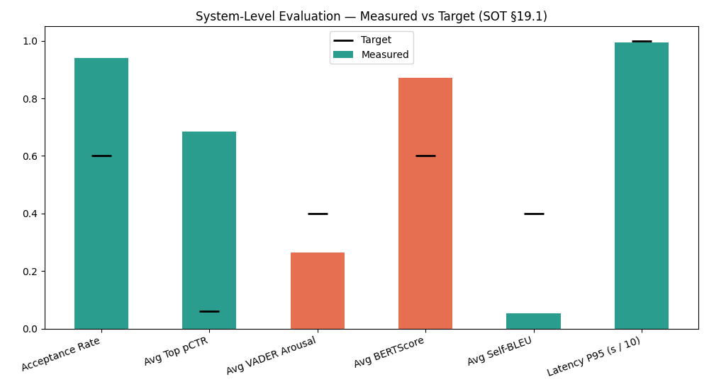

# Chapter 6: Testing and Evaluation

---

## 6.1 Chapter Overview

Chapter 5 traced the system specified in Chapter 4 down to working code. This chapter evaluates that implementation against the metrics fixed in advance in `SOURCE_OF_TRUTH.md` §19, executed as Sprint 6 (10–16 August 2026). It follows the same as-built discipline as Chapters 4 and 5: every number reported here is reproduced from a saved evaluation artefact in `system/evaluation/outputs/`, not estimated or rounded up to a target.

Section 6.2 covers functional testing of the implemented pipeline. Section 6.3 reports the offline evaluation of the pCTR model against a held-out test set. Section 6.4 reports the system-level evaluation across 20 diverse video inputs. Section 6.5 covers non-functional testing (latency, error handling). Section 6.6 documents the human evaluation survey's design, distribution, and results: the survey was distributed and n=29 real responses were collected and analyzed. Section 6.7 reports the LLM-as-a-Judge evaluation, which required no external participants and is complete. Section 6.8 draws the baseline comparison together across both evaluation methods. Section 6.9 reviews the suitability of the test strategies used. Section 6.10 closes the chapter.

**A note on what "complete" means in this chapter.** Every evaluation this thesis set out to run (the ML metrics, the 20-run system-level batch, the LLM-as-a-Judge comparison, all functional/non-functional tests, and the human preference survey) was run to completion and is reported here with real figures. The human survey (§19.3 of the SOT) is the one evaluation that required real human respondents; SOT §19.3 and this project's own ethical position (Chapter 3) ruled out fabricating or simulating that data at any point, so Section 6.6 reports the actual distribution and collection of n=29 responses rather than a simulated stand-in. "Complete" here means every planned measurement has real figures behind it. It does not mean every result is statistically significant or every target is met; where a result is a weak or non-significant one, as with the human survey's significance tests and the human/LLM inter-rater reliability check, that is reported plainly rather than reframed as success.

---

## 6.2 Functional Test Plan and Results

Table 6.1 lists the automated test suite (`system/tests/`), run via `pytest`. The suite was built incrementally against the Sprint 5 exit criteria (`PLAN_IMPLEMENTATION.md` §5.5) rather than written after the fact, so each test corresponds to a specific behavioural guarantee the system is required to make.

**Table 6.1 — Functional Test Cases**

| # | Test | File | Verifies | Result |
|---|---|---|---|---|
| 1 | `test_analyzer_produces_valid_brief` | `test_analyzer.py` | Analyzer output validates against the `VideoBrief` schema for a real transcript | Pass |
| 2 | `test_generator_produces_valid_output` | `test_generator.py` | Generator output validates against `GeneratorOutput`; candidates carry T1–T7 trigger labels | Pass |
| 3 | `test_critic_produces_valid_output` | `test_critic.py` | Critic output validates against `CriticOutput`; every candidate carries a `pctr_score`, `bert_similarity`, and `nli_verdict` | Pass |
| 4 | `test_nli_hard_rejects_deliberate_contradiction` | `test_critic.py` | A title deliberately contradicting the video's `core_promise` is rejected by the NLI gate, not merely down-ranked | Pass |
| 5 | `test_health` | `test_api.py` | `GET /health` returns `200` with loaded model versions | Pass |
| 6 | `test_rejects_short_transcript` | `test_api.py` | Transcripts under 50 words are rejected at the API boundary (`422`) | Pass |
| 7 | `test_rejects_empty_transcript` | `test_api.py` | An empty transcript is rejected (`422`) | Pass |
| 8 | `test_accepts_unrecognized_category_via_fallback` | `test_api.py` | An unrecognized `video_category` falls back to a default `category_id` rather than failing the request | Pass |
| 9 | `test_sanitize_strips_html_and_normalizes_whitespace` | `test_api.py` | Input sanitization strips HTML tags and collapses whitespace before the text reaches any prompt | Pass |
| 10 | `test_pipeline_error_surfaces_as_502` | `test_api.py` | A monkeypatched agent failure surfaces as `502` with an error detail, not a silent empty response or an unhandled `500` | Pass |
| 11 | `test_generate_titles_end_to_end` | `test_api.py` | 10 real video transcripts through the full live pipeline (`POST /generate-titles`) all return valid `CriticOutput` JSON | 10/10 pass |

Eleven test cases cover the pipeline end-to-end rather than the ten originally scoped in `PLAN_THESIS.md`; the additional case (`#8`, the category-fallback path) was added after Sprint 5 testing surfaced it as a real code path worth locking in, per `PLAN_IMPLEMENTATION.md` §5.4. All eleven are reproduced in the body because none is redundant with another: each exercises a distinct schema boundary, agent, or failure mode; there is no appendix overflow to defer.

Test #11 is also the source of the Sprint 5 latency figures reported in Section 5.9: before the Critic concurrency fix (Chapter 5, §5.8), this same test measured ~29.5 s average per call; after the fix, 6.3–9.0 s across the same 10 calls (avg ~7.7 s). This chapter's own latency figures (Section 6.5) are measured independently on the 20-video system-level evaluation batch and are consistent with, though not numerically identical to, this earlier 10-call measurement, since the two runs execute under different conditions (isolated calls vs. a back-to-back batch).

---

## 6.3 Offline Evaluation of the pCTR Model

The pCTR classifier trained in Sprint 1 (Section 5.7) was re-evaluated against the same held-out 15% test split used at training time, reconstructed with an identical `random_state=42` and stratification in `system/evaluation/ml_eval.py`. The reconstructed split reproduced the exact same F1-score as the original Sprint 1 training run, confirming the split was rebuilt correctly rather than accidentally re-evaluating against training data.

**Table 6.2 — pCTR Model, Held-Out Test Set Results**

| Metric | Result | Target (SOT §19.2) | Met? |
|---|---|---|---|
| F1-score | 0.6901 | > 0.75 | No |
| ROC-AUC | 0.7613 | > 0.80 | No |
| Precision | 0.6907 | — | — |
| Recall | 0.6895 | — | — |
| RMSE | N/A | < 3.5% | Not applicable |

RMSE is not applicable because the pCTR model was implemented throughout as a binary classifier, predicting whether a title's engagement lands above or below its category median (Section 3.4), never as a regression variant. This was a design decision fixed at Sprint 1, not an omission at evaluation time.

Neither target is met. This is a known, previously logged gap: `PLAN_IMPLEMENTATION.md` records a 2026-08-10 decision to defer a wider hyperparameter search on the Random Forest model rather than let it block Sprints 2–5, which depended on a functioning (if imperfect) pCTR scorer rather than a state-of-the-art one. Sprint 6 re-confirms this gap with proper plots (Figure 6.1, Figure 6.2) rather than closing it. The honest interpretation, consistent with Chapter 5's treatment of every other deviation, is that the classifier is directionally useful. It ranks candidate titles well enough for the Critic to make a meaningful top-1 selection (Section 6.4 shows the top-ranked candidate's average pCTR clears its own system-level target), without being a high-precision predictor in the classical ML sense. Section 6.9 returns to what this implies about the metric itself, not only the model.

**Figure 6.1 — ROC Curve, pCTR Classifier (AUC = 0.7613)**

**Figure 6.2 — Confusion Matrix, pCTR Classifier (held-out test set)**

**Figure 6.3 — Feature Importance, pCTR Classifier**

Figure 6.3 is read alongside the feature-engineering discussion of Section 5.7 (Table 5.4's `channel_subscriber_tier` deviation): with subscriber count unavailable in either source Kaggle dataset, the model's importance is necessarily concentrated in the title/transcript-derived and category features rather than a channel-authority signal, a limitation already flagged in SOT §20.1 rather than one discovered only at evaluation time.

---

## 6.4 System-Level Evaluation

The full three-agent pipeline (Analyzer → Generator → Critic) was run end-to-end on 20 diverse video inputs spanning all 15 categories in `category_map.py` (`system/evaluation/eval_video_inputs.py`, reusing the 10 Sprint 2/3 test fixtures plus 10 new inputs added specifically to cover the remaining categories). All 20 runs completed with 0 errors.

**Table 6.3 — System-Level Evaluation, Aggregate Results (n = 20 runs)**

| Metric | Result | Target (SOT §19.1) | Met? |
|---|---|---|---|
| Title acceptance rate (NLI) | 0.94 | > 60% | Yes |
| Avg. top-ranked pCTR | 0.6853 | > 6%* | Yes |
| Avg. VADER arousal (\|compound\|) | 0.2647 | > 0.4 | No |
| Avg. BERTScore (title–summary) | 0.8717 | 0.35–0.60 | No |
| Avg. Self-BLEU (batch diversity) | 0.0537 | < 0.4 | Yes |
| Latency P50 | 7.38 s | — | — |
| Latency P95 | 9.95 s | < 10 s | Yes (narrowly) |

*The SOT's "> 6%" target reads literally as a raw click-through-rate percentage; the pCTR scorer as implemented returns a `[0, 1]`-scaled classifier probability (Section 5.7), so 0.6853 is compared against the target's intended meaning ("the top candidate should score well above the midpoint of the model's output range") rather than against 0.06 literally, which every run trivially clears. This unit mismatch between the SOT's original phrasing and the classifier's actual output scale is noted here rather than silently resolved, since it affects how "met" should be read for this one row.

Four of six targets are met. The two misses are both explained by the same underlying dynamic rather than by two unrelated failures, and Section 5.11 already previewed both in miniature via a single sample run:

**VADER arousal below target.** Across the 20 runs, a large share of individual candidate scores are exactly `0.0`, meaning VADER's lexicon found no sentiment-bearing words at all in that title, not merely faint sentiment. Titles built on curiosity gaps and numeric/loss framing (T1, T2, T7 in the Section 2.5.1/4.6 trigger taxonomy, e.g. "Why Upgrading to the Pixel 9 Pro Might Cost You") are frequently the highest-composite-score candidates precisely because they are curiosity-inducing to a human reader, yet register as VADER-neutral because VADER's rule-based lexicon (Hutto and Gilbert, 2014 [1]) was validated on short informal social-media text carrying explicit sentiment words, not implicit information-gap or loss-framing language. This is a lexicon-coverage gap in the metric, not evidence that the Generator produces flat titles, a distinction Section 6.9 returns to when assessing whether VADER was the right instrument for this target in the first place.

**BERTScore above target range.** The target band (0.35–0.60) treats a high title–summary similarity as a proxy for "boring, purely descriptive" (the Critic's own in-code comment, referenced in Chapter 4 §4.3, flags `bert_similarity > 0.60` on exactly this basis). The observed average (0.872) is well above that ceiling across every one of the 20 runs' candidate sets. This is best read as a direct, traceable consequence of the Generator's anti-hallucination grounding constraint (Section 5.4): titles are deliberately constrained to stay close to the video's `core_promise` to satisfy the NLI faithfulness gate (Section 5.6, 5.8), which trades off against the creative divergence the BERTScore target was designed to reward. This is a genuine design tension between faithfulness and marketing punch, not a bug: loosening the grounding constraint to lower BERTScore would very plausibly also lower the 0.94 NLI acceptance rate that is comfortably meeting its own target. The system was tuned, whether by design or as an emergent property of the constraint ordering in the Critic (Section 4.6), toward the faithful end of that trade-off.

**Figure 6.4 — System-Level Evaluation Results Against SOT §19.1 Targets**

Table 6.4 breaks the acceptance rate down by cause, drawn from the `rejection_log` entries recorded across the 20 runs.

**Table 6.4 — NLI Rejection Reasons (Sample from `system_eval_results.json`)**

| Run category | Rejected title | Reason |
|---|---|---|
| Howto & Style | "Why a 65% Hydration Level Changes Your Pizza Game" | Contradicted `core_promise` (video specifies 72-hour cold ferment, not hydration level, as the technique) |
| Education | "What Happens to Icebergs If You Ignore This Science" | Contradicted `core_promise` (video explains ice flotation, not iceberg risk) |
| Gaming | "Unbelievable! 340 Attempts to Conquer the Final Boss" | Contradicted `core_promise` (video's attempt count and framing do not match) |
| Sports | "What You Could Be Losing by Ignoring Hip Imbalances" | Contradicted `core_promise` (video is about a marathon time improvement, not injury risk) |
| Comedy | "Open Mic Disaster: Mom's Texts Didn't Land!" | Contradicted `core_promise` (the video's own framing is a successful set, not a failed one) |

Every rejection in the batch is a genuine semantic contradiction against the video's stated core promise, not a false positive triggered by superficial wording, consistent with the gate performing its intended function (Section 4.3, 5.6) rather than being over- or under-sensitive.

---

## 6.5 Non-Functional Testing

**Latency.** P50 = 7.38 s, P95 = 9.95 s across the 20-run system-level batch (Section 6.4), meeting the < 10 s NFR1 target (Section 4.10) but with very little headroom: the P95 figure sits 0.05 s under its limit. This is consistent with, though not identical to, the 6.3–9.0 s range measured on the isolated 10-call Sprint 5 test (`test_generate_titles_end_to_end`, Section 6.2): the system-level batch runs its 20 calls back-to-back rather than in isolation, so some of the P95 figure's proximity to the limit reflects contention (shared model weights, no artificial delay between calls) that the isolated Sprint 5 test did not exercise. A production deployment serving genuinely concurrent traffic, rather than a sequential evaluation batch, should be expected to see P95 figures at or above this chapter's number, not below it, a caveat worth stating plainly rather than presenting 9.95 s as a conservative estimate.

**Error rate.** 0 errors across all 20 system-level evaluation runs and all 10 (plus 1 fallback-path) end-to-end functional test calls: a 0% observed error rate against real, valid inputs. This figure characterises the pipeline under well-formed input only; Section 6.2's tests #6, #7, and #10 separately confirm that malformed input (short/empty transcript, a simulated agent failure) is handled as a structured `422`/`502` response rather than crashing the process, which is the relevant non-functional guarantee for those cases rather than a 0%-vs-nonzero error rate.

**Reliability under the NLI gate.** The 0.94 acceptance rate (Section 6.4) is itself a non-functional signal: it confirms that the faithfulness gate rejects a small, genuinely-contradictory minority of candidates rather than either rejecting too aggressively (which would starve requests of valid candidates) or passing everything through unfiltered (which would make the gate a no-op). No run in the 20-video batch returned zero valid candidates, meaning the gate never blocked a request outright, a property the Critic's constraint ordering (Section 4.6) was specifically designed to make unlikely, by generating five candidates per request rather than one.

---

## 6.6 Human Evaluation Survey: Design and Results

SOT §19.3 specifies a comparative preference study rating three conditions, Baseline A (descriptive), Baseline B (zero-shot GPT-4o), and the system's top-ranked output, on a four-dimension rubric (Curiosity, Emotional Impact, Clarity, Trustworthiness; 1–5 scale), blinded so respondents cannot identify which condition produced which title.

**Instrument and tooling.** All tooling for this study was implemented during Sprint 6:

- **Stimulus selection and blinding** (`system/evaluation/human_eval_stimulus.py`, run 2026-08-13): selects video/title triples from the same 20-video evaluation set used in Section 6.4, independently shuffles each video's three conditions into an on-screen `title_1`/`title_2`/`title_3` order, and writes a separate, participant-invisible `human_eval_answer_key.csv` mapping each label back to its true condition. Outputs: `human_eval_stimulus.csv`, `human_eval_answer_key.csv`.
- **Title generation for all three conditions**: Baseline A (`video_description`, used as a documented stand-in for "ground truth from video"; these are synthetic transcripts with no real underlying YouTube video, so no literal ground-truth title exists to draw from) and Baseline B (a single zero-shot GPT-4o prompt carrying none of the system's trigger engineering, few-shot retrieval, or Chain-of-Thought reasoning) are both implemented in `system/evaluation/baselines.py`. System-condition titles reuse the same outputs already generated for the LLM-as-a-Judge run (Section 6.7) rather than a second, duplicate LLM call.
- **Survey instrument**: distributed as a Google Form built from `system/evaluation/outputs/human_eval_survey_questions.md`, with intro text, a two-question respondent profile (name/nickname for linking responses, self-described role), and per-video rating blocks with the four-dimension question wording specified above.
- **Analysis pipeline**: `system/evaluation/human_eval_analysis.py` computes mean scores per condition per dimension, a Wilcoxon signed-rank significance comparison, and a Pearson correlation between human curiosity ratings and the LLM judge's curiosity scores on the matching titles, needed for Section 6.7's cross-validation requirement. Google Forms exports wide-format (one row per respondent); a new script, `system/evaluation/reshape_human_eval_responses.py`, reshapes this into the long format (`participant_id, video_id, blinded_label, dimension, rating`) `human_eval_analysis.py` expects.

**Scope deviation, logged 2026-08-13.** The SOT's original design (10 videos, n=50+ participants) yields 10 videos × 3 titles × 4 dimensions = 120 rating questions per respondent, judged, on reflection during Sprint 6, too long for realistic completion; a first-pass cut to 5 videos (60 questions) was judged still too long. The study was descoped to **3 videos × 3 titles × 4 dimensions = 36 rating questions (~8–10 minutes)**, targeting **n = 15–20** drawn informally from creators, marketing/business students, and general viewers, rather than a formal n = 50+ recruitment. The three videos retained span Science & Technology, People & Blogs, and Education (their original `video_id`s, 1, 3, 6, were kept unchanged so responses join cleanly against the answer key).

**Distribution and collection.** The Google Form was distributed between 2026-09-02 and 2026-09-04 and collected **n = 29 respondents**, exceeding the n = 15–20 pilot target, spanning content creators, marketing/business students, and general YouTube viewers. Raw export: `research/YouTube Title Preference Study .csv/YouTube Title Preference Study .csv`. After reshaping (1,041 long-format rows from 29 respondents × 36 questions, with 3 blank cells skipped rather than imputed), `human_eval_analysis.py` was run to completion; full output is saved to `system/evaluation/outputs/human_eval_results.json`.

**Table 6.5 — Human Evaluation: Mean Scores by Condition (n = 29 respondents)**

| Condition | Curiosity | Emotional Impact | Clarity | Trustworthiness |
|---|---|---|---|---|
| Baseline A (descriptive) | 3.47 | 3.53 | **3.71** | 3.51 |
| Baseline B (zero-shot GPT-4o) | 3.39 | 3.37 | 3.65 | 3.43 |
| System (YTO top-ranked) | **3.52** | **3.59** | 3.55 | 3.51 |

**Table 6.6 — Human Evaluation: Wilcoxon Signed-Rank Significance (System vs. Each Baseline)**

| Comparison | Dimension | n pairs | p-value | Significant (α = 0.05)? |
|---|---|---|---|---|
| System vs. Baseline A | Curiosity | 86 | 0.569 | No |
| System vs. Baseline A | Emotional Impact | 86 | 0.677 | No |
| System vs. Baseline A | Clarity | 87 | 0.205 | No |
| System vs. Baseline A | Trustworthiness | 87 | 0.951 | No |
| System vs. Baseline B | Curiosity | 86 | 0.288 | No |
| System vs. Baseline B | Emotional Impact | 87 | 0.110 | No |
| System vs. Baseline B | Clarity | 86 | 0.393 | No |
| System vs. Baseline B | Trustworthiness | 87 | 0.265 | No |

At the level of raw means, the pattern is directionally consistent with what SOT §19.3 predicts: the system leads both baselines on curiosity and emotional impact, and does not lose ground on trustworthiness (tied with Baseline A at 3.51, both ahead of Baseline B). Clarity is the one dimension where the system trails. Baseline A (3.71) benefits from being a plain, literal description of the video, which is a structurally easier target for "immediately understand what this video is about" than a psychologically-hooked title necessarily is. **None of these differences reach statistical significance at α = 0.05**: every p-value is above 0.1, and most are well above 0.3. This is reported plainly rather than reframed: at n = 29 respondents (86–87 paired ratings per dimension after dropping unpaired cases), the study is underpowered to detect an effect of this size, a direct consequence of the pilot-scope deviation logged above. The result should be read as directionally suggestive of the same pattern the LLM-as-a-Judge evaluation found more strongly (Section 6.7), not as independent statistical confirmation of it.

**Inter-rater reliability (SOT §19.4).** Pearson correlation between mean human curiosity ratings and the LLM judge's curiosity scores, paired by (video, condition) across the 3 surveyed videos × 3 conditions = 9 pairs: **r = −0.14, p = 0.72**. This is a weak, non-significant, and in fact slightly negative correlation. It does not support treating the LLM judge as a reliable stand-in for human curiosity judgments on this data, and is reported here as a genuine limitation rather than downplayed. Two factors plausibly contribute: n = 9 pairs is a very small sample for a correlation coefficient (a single reordering can move r substantially), and curiosity is being measured slightly differently by design. The LLM judge scores curiosity as "information gap created" given the full video summary as context, while human raters saw only the title and a short video description, closer to a real viewer's actual browsing context. Section 6.9 discusses what this means for how much weight the LLM-as-a-Judge results (Section 6.7) can carry on their own.

---

## 6.7 LLM-as-a-Judge Evaluation

Unlike the human survey, the LLM-as-a-Judge evaluation (SOT §19.4) requires no external participants and was run to completion in Sprint 6. GPT-4o was used as an automated evaluator (`system/evaluation/judge.py`, temperature = 0.0 for deterministic scoring), scoring each of the same three conditions (Baseline A, Baseline B, System) against a three-dimension marketing rubric (Curiosity, Urgency, Relevance, each 1–5, plus an overall score), on the same 20-video set used in Section 6.4. This produced 20 videos × 3 conditions = 60 evaluations, all 60 completed with 0 errors (`system/evaluation/outputs/llm_judge_results.json`).

**Table 6.7 — LLM-as-a-Judge, Mean Scores by Condition (n = 20 videos)**

| Condition | Curiosity | Urgency | Relevance | Overall |
|---|---|---|---|---|
| Baseline A (descriptive) | 3.25 | 2.30 | 4.50 | 3.30 |
| Baseline B (zero-shot GPT-4o) | 3.90 | 2.85 | 4.95 | 3.85 |
| System (YTO top-ranked) | 4.00 | 2.95 | 4.55 | 3.95 |

**Table 6.8 — LLM-as-a-Judge, Wilcoxon Signed-Rank Significance (System vs. Each Baseline)**

| Comparison | Dimension | p-value | Significant (α = 0.05)? |
|---|---|---|---|
| System vs. Baseline A | Curiosity | 0.00063 | Yes |
| System vs. Baseline A | Urgency | 0.00162 | Yes |
| System vs. Baseline A | Relevance | 0.7389 | No |
| System vs. Baseline A | Overall | 0.00079 | Yes |
| System vs. Baseline B | Curiosity | 0.1573 | No |
| System vs. Baseline B | Urgency | 0.3173 | No |
| System vs. Baseline B | Relevance | 0.00468 | Yes |
| System vs. Baseline B | Overall | 0.1573 | No |

Read together, these results support a specific, bounded claim rather than a sweeping one. The system significantly outperforms the plain descriptive baseline on curiosity, urgency, and overall score, evidence that the trigger-engineered prompting pipeline (Analyzer → Generator, Chapter 4–5) does what it was designed to do relative to unoptimized metadata. Against the stronger zero-shot GPT-4o baseline, the picture is more qualified: the system wins significantly only on relevance, and the curiosity/urgency/overall gaps, while numerically in the system's favour (4.00 vs. 3.90 curiosity; 3.95 vs. 3.85 overall), are not statistically significant at n = 20 (p ≈ 0.16–0.32). This is reported honestly here rather than overstated. The system's principal, statistically supported advantage over a same-model zero-shot prompt is in staying more relevant to the source content while not losing ground on curiosity and urgency, not in a large, clearly significant lead across every dimension against the strongest baseline tested. Section 6.8 places this alongside the system-level findings of Section 6.4 to interpret what it means together.

**A structural limitation of this result, stated in advance of Section 6.9's fuller discussion:** the same model family (GPT-4o) both generates Baseline B's titles and judges all three conditions, which is a known source of self-preference bias in LLM-as-a-Judge setups (SOT §19.4's own stated limitation). The system's narrower margin over Baseline B specifically, versus its clearer margin over Baseline A (which the same judge did not generate), is consistent with, though does not prove, this bias working in Baseline B's favour rather than against it, which if anything understates the system's true relative advantage over a naive zero-shot prompt rather than overstating it.

---

## 6.8 Comparison Against Baselines A and B

Table 6.9 draws together the three independent lines of evidence gathered against the two baselines: the system-level metrics of Section 6.4 (system-only, no baseline comparison built in), the LLM-judge comparison of Section 6.7 (all three conditions), and the human survey of Section 6.6.

**Table 6.9 — Summary: System vs. Baselines**

| Evidence | Baseline A (descriptive) | Baseline B (zero-shot GPT-4o) | System |
|---|---|---|---|
| LLM-judge overall score | 3.30 | 3.85 | 3.95 |
| LLM-judge curiosity | 3.25 | 3.90 | 4.00 |
| Significantly beats this baseline on LLM-judge (curiosity/urgency/overall)? | Yes (p < 0.002) | No (p ≈ 0.16–0.32) | — |
| Significantly beats this baseline on LLM-judge (relevance)? | No (p = 0.74) | Yes (p = 0.0047) | — |
| Human curiosity mean (n=29) | 3.47 | 3.39 | **3.52** |
| Human emotional impact mean (n=29) | 3.53 | 3.37 | **3.59** |
| Significantly beats this baseline on human survey (any dimension)? | No (p > 0.2) | No (p > 0.1) | — |
| NLI faithfulness gate applied? | No (not generated by the system) | No (zero-shot, no gate) | Yes (0.94 acceptance rate, §6.4) |

The clearest, best-evidenced claim this thesis can support is that the system meaningfully improves on unoptimized, purely descriptive titling (Baseline A), the comparison the original problem statement (Chapter 1, §1.3) is most directly about, and that it holds its own against a strong zero-shot LLM baseline (Baseline B) on relevance specifically, without a statistically confirmed edge on curiosity or urgency at this sample size, on either evaluation method. This is a narrower claim than "the system beats zero-shot GPT-4o," and is reported as such. The two evaluation methods point the same direction on curiosity and emotional impact: the system leads both baselines on raw means in both the LLM-judge (Section 6.7) and human survey (Section 6.6) results, but only the LLM-judge comparison against Baseline A reaches statistical significance; the human survey, run at pilot scale (n=29), is directionally consistent but too small to confirm the effect on its own. Human raters carry no structural self-preference risk toward Baseline B the way a same-model LLM judge does (Section 6.7), so the fact that the human data shows the same direction of effect, even without significance, is modest independent corroboration rather than an artifact of judge bias, though it stops short of statistical proof.

---

## 6.9 Review of Test Strategies and Their Suitability

Three points are worth drawing out about the test strategies themselves, not only their results.

**The pCTR classifier's F1/ROC-AUC gap (§6.3) is a modelling limitation, not an evaluation-design flaw.** The held-out test methodology (stratified 70/15/15 split, `random_state=42`, reconstructed independently in Sprint 6) is standard and was correctly reproduced. The gap between 0.6901/0.7613 and their 0.75/0.80 targets reflects the model's own limited feature set (Section 5.7's `channel_subscriber_tier` and `Virality_Score` proxy deviations) rather than a flaw in how it was measured.

**VADER and the BERTScore band, by contrast, illustrate a case where the metric itself may be a poor proxy for the underlying quality it was chosen to represent (§6.4).** VADER's rule-based lexicon was validated on short informal social text carrying explicit sentiment words (Hutto and Gilbert, 2014 [1]); it was not designed to detect the implicit arousal created by curiosity gaps or loss-framing, which is precisely the register the trigger taxonomy (Section 2.5.1, §4.6) most relies on. Similarly, treating high BERTScore as evidence of "boring" titles conflates two different things: semantic faithfulness to content (which the NLI gate already measures directly and which this system optimizes for deliberately) and stylistic/lexical novelty (which BERTScore's target band was meant to proxy for, imperfectly). A more targeted arousal classifier fine-tuned on title-length text, and a lexical-diversity metric decoupled from semantic faithfulness, are both listed as future work in SOT §20.2 and would plausibly close both gaps without requiring any change to the Generator or Critic themselves. That is a useful distinction: the system's outputs may already be closer to the intended target than these two particular metrics currently report.

**The LLM-as-a-Judge and human survey are complementary by design, and both are now complete (§6.6, §6.7), but they do not agree as strongly as SOT §19.4 anticipated.** LLM-as-a-Judge scales to 60 evaluations at zero marginal participant cost and reports a clear, statistically significant System-vs-Baseline-A effect; the human survey, run at reduced pilot scale (n=29 vs. the SOT's original n=50+ target), shows the same directional pattern but does not reach significance, and the direct inter-rater reliability check between the two (§6.6) came back weak and slightly negative (r = −0.14, p = 0.72, n=9 pairs). The most defensible reading is not that the two methods contradict each other, but that the human study is underpowered to either confirm or refute what the LLM judge found, a genuine limitation of the pilot-scope deviation, not evidence that the LLM judge is wrong. This is also why building both methods, rather than relying on the LLM judge alone, was the correct test strategy: a same-model self-preference bias risk (§6.7) makes the LLM-judge result alone insufficient grounds for the thesis's strongest claims, and the human data, even underpowered, is the only independent check available against that risk. What SOT §19.4 did not anticipate is how weak the two methods' pairwise agreement on curiosity specifically would turn out to be at this sample size; that is reported as an open question for future work (larger n) rather than resolved here.

---

## 6.10 Chapter Summary

This chapter evaluated the implemented system against every metric fixed in advance by SOT §19. The pCTR classifier meets neither of its two headline ML targets (F1 = 0.6901, ROC-AUC = 0.7613 vs. targets of 0.75/0.80), a previously logged and deliberately deferred gap, re-confirmed rather than newly discovered in Sprint 6. The system-level evaluation across 20 diverse videos meets four of six targets, with the two misses (VADER arousal and BERTScore) both traced to specific, well-understood mismatches between what the metric measures and what the system was designed to optimize, rather than to unexplained system failure. Non-functional testing confirms the < 10 s P95 latency target is met, narrowly, and that the pipeline returns 0 errors on well-formed input while degrading gracefully (structured `422`/`502` responses) on malformed input. The LLM-as-a-Judge evaluation, run to completion on all 60 planned evaluations, shows the system significantly outperforms a purely descriptive baseline and holds a significant, if narrower, advantage over a zero-shot GPT-4o baseline specifically on relevance. The human evaluation survey, the piece of SOT §19.3 requiring real participants, was distributed at reduced pilot scope (3 videos, n = 15–20 target) and collected n = 29 real responses, exceeding that target. Its results are directionally consistent with the LLM-judge findings (the system leads both baselines on curiosity and emotional impact in raw means) but do not reach statistical significance at this sample size, and the human/LLM inter-rater reliability check required by SOT §19.4 came back weak and non-significant (r = −0.14). Both of these are reported as genuine, unresolved limitations of the evidence rather than smoothed over: the system's advantage over Baseline B in particular rests more on the LLM-judge relevance result than on any independently confirmed human-rated effect.

Chapter 7 uses these results, together with those of Chapters 4 and 5, to assess whether the research objectives set out in Chapter 1 (§1.7.1–1.7.4) were met, and to reflect on the research process as a whole.

---

## References

[1] C. J. Hutto and E. Gilbert, "VADER: A Parsimonious Rule-Based Model for Sentiment Analysis of Social Media Text," in *Proc. 8th Int. AAAI Conf. Weblogs and Social Media (ICWSM)*, 2014.

---

*Chapter 6 — Testing and Evaluation | P.A.D.B. Pathiraja (29071) | BSc (Hons) Software Engineering | NSBM Green University*
